# Painel AR — Identificação de Componentes em Painéis Elétricos

> **UPX — Realidade Aumentada · Centro Universitário Facens**  
> Prova de conceito de aplicativo Android de Realidade Aumentada baseada em marcadores para apoiar a identificação de componentes e a execução guiada de um procedimento de manutenção em um painel elétrico, avaliada por meio de um estudo piloto de viabilidade com um painel virtual exibido em tela.


-green)


---

## 1. Identificação do Projeto

| Item | Informação |
|---|---|
| **Projeto** | Painel AR — Realidade Aumentada Baseada em Marcadores para Apoio à Identificação de Componentes e Execução de Procedimentos de Manutenção em Painéis Elétricos |
| **Equipe** | Equipe 4 |
| **Curso** | Engenharia de Computação |
| **Disciplina** | UPX — Realidade Aumentada |
| **Professor** | Daniel Ohata |
| **Semestre** | 2026.2 |
| **Instituição** | Centro Universitário Facens — Sorocaba, SP |

### Integrantes

| Nome | RA | Responsabilidade |
|---|---|---|
| Enrico Affonso Fernandes Alves | 210141 | Desenvolvimento AR |
| Guilherme Luiz Rodrigues Ifanger | 235438 | Documentação |
| Kauan Michael de Freitas | 236023 | Desenvolvimento AR |

---

## 2. Visão Geral

Operadores em treinamento e técnicos menos experientes costumam depender de manuais impressos, etiquetas ou memória para localizar o componente certo de um painel elétrico antes de um procedimento de manutenção, e um erro de identificação aumenta o risco da atividade.

Para apoiar essa identificação, o **Painel AR** é um aplicativo Android de Realidade Aumentada que reconhece marcadores impressos colados ao lado dos componentes de um painel elétrico. Nos testes, o painel é um painel virtual exibido na tela de um computador, com os marcadores impressos fixados ao lado de cada componente. Ao apontar a câmera para um marcador, o aplicativo mostra o nome do componente, sua função e alertas de segurança, e conduz o usuário por um procedimento de manutenção simulado de 15 etapas.

O aplicativo é o instrumento da condição experimental de RA de um **estudo piloto de viabilidade**, descrito no artigo científico da equipe. Durante a tarefa, ele registra cada identificação feita pelo participante e calcula a **taxa de erros de identificação**, que é comparada com o uso de documentação impressa de conteúdo equivalente. O piloto verifica se o protocolo e o aplicativo funcionam nas condições do experimento e produz evidências preliminares, sem pretensão de demonstrar eficácia generalizável.

Não há intervenção elétrica real: como não foi possível usar um painel físico, os testes usam um painel virtual exibido em tela. O conteúdo técnico (versão `0.2-provisoria`) foi elaborado pela equipe.

> **Estado atual:** o aplicativo está implementado, com os conjuntos de etapas A e B e o rodízio dos participantes. Foi testado no computador com o **XR Simulation** do AR Foundation (Seção 22.1), num teste preliminar no smartphone em 27/10/2026 (Seção 22.2) e nos testes técnicos no smartphone, feitos remotamente com o painel virtual em tela e os marcadores impressos em 8 × 8 cm (Seção 22.3). Nesses testes, o reconhecimento, a associação, o desempenho, a estabilidade, a operação offline e o registro de dados atenderam aos critérios; o reconhecimento por distância funciona até cerca de 40 cm com marcadores de 8 cm. O **estudo piloto** foi feito com 4 participantes, em coleta remota (Seção 25.1). Os erros com o app vieram da confirmação com a mira em movimento ou sobre o marcador da etapa anterior; depois do piloto, a confirmação passou a exigir 0,5 s de mira parada, correção verificada na Seção 22.4.

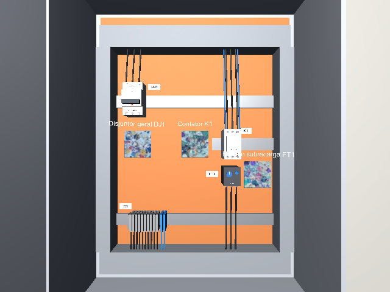

---

## 3. Problema

Atividades de manutenção elétrica expõem o trabalhador a riscos como choque elétrico e arco elétrico. Um dos fatores que pode agravar esse risco é o erro na identificação de componentes: operadores em treinamento e profissionais menos experientes costumam depender de manuais impressos, etiquetas físicas ou memorização para localizar o componente certo antes de executar um procedimento.

A RA já é aplicada em manutenção industrial, mas, nos trabalhos analisados pela equipe, não foi encontrada uma avaliação experimental que compare uma aplicação de RA real, baseada em marcadores, com documentação impressa equivalente quanto à taxa de erros de identificação em um painel elétrico físico.

**Questão de pesquisa (RQ1):** qual é o efeito do uso de uma aplicação de RA baseada em marcadores, em comparação ao uso de documentação tradicional impressa, sobre a taxa de erros de identificação de componentes durante a execução de um procedimento de manutenção em um painel elétrico simulado?

**Hipótese (H1):** usuários que utilizam a aplicação de RA apresentarão menor taxa de erros na identificação dos componentes do que usuários que utilizam documentação impressa.

Por se tratar de um estudo piloto com amostra reduzida, a H1 é explorada de forma descritiva: os resultados indicam se os dados são compatíveis ou não com a hipótese, sem testá-la estatisticamente.

---

## 4. Objetivos

### 4.1 Objetivo Geral

Desenvolver e avaliar, por meio de um estudo piloto de viabilidade, uma prova de conceito de aplicação móvel de Realidade Aumentada baseada em marcadores para apoiar a identificação de componentes e a execução guiada de um procedimento de manutenção em um painel elétrico simulado, sem intervenção elétrica real.

### 4.2 Objetivos Técnicos

- Configurar um projeto Unity com AR Foundation e ARCore para Android.
- Reconhecer três marcadores impressos, cada um associado a um componente do painel.
- Exibir, sobre cada marcador, o nome do componente e um destaque visual.
- Mostrar função e alertas de segurança do componente que está na mira.
- Conduzir um procedimento de 15 etapas com alerta obrigatório antes das etapas críticas.
- Registrar em CSV, no próprio aparelho, cada evento da sessão e cada identificação (correta ou incorreta).
- Gerar a documentação impressa a partir do mesmo arquivo de conteúdo do aplicativo.
- Executar testes técnicos de reconhecimento, desempenho e estabilidade antes do experimento.

---

## 5. Público-Alvo

Operadores em treinamento, estudantes de cursos técnicos e de engenharia e profissionais menos experientes que precisam identificar componentes de um painel elétrico antes de executar um procedimento de manutenção.

No estudo piloto, participaram 4 voluntários, recrutados por conveniência: adultos (18 anos ou mais), estudantes, sem atuação profissional em manutenção de painéis elétricos e que não integram a equipe. A familiaridade de cada um com componentes elétricos e com RA foi registrada no formulário de caracterização. Cada participante realizou as duas condições (app e manual), com a ordem e o conjunto de etapas alternados entre participantes (Seção 11.5). Resultados na Seção 25.1.

Materiais complementares (perfil dos participantes, termo de consentimento, protocolo do experimento) ficam em `docs/documents/`.

---

## 6. Funcionalidades

| ID | Funcionalidade | Descrição | Status | Verificado em |
|---|---|---|---|---|
| RF01 | Acessar o painel pela câmera | Abre a câmera em modo RA e inicia a sessão do participante, com o conjunto de etapas escolhido (A ou B) | ✅ | Smartphone |
| RF02 | Reconhecer marcadores | Reconhece os 3 marcadores cadastrados na Reference Image Library | ✅ | Smartphone |
| RF03 | Identificar o componente | O participante aponta a mira para um marcador e confirma | ✅ | Smartphone |
| RF04 | Conhecer o componente | Mostra nome, função e alerta do componente na mira | ✅ | Smartphone |
| RF05 | Agir com segurança | Exibe alerta obrigatório antes das etapas críticas | ✅ | Smartphone |
| RF06 | Seguir o procedimento | Conduz as 15 etapas do conjunto escolhido e destaca o componente pedido | ✅ | Smartphone |
| RF07 | Medir o desempenho | Grava um CSV por sessão com todos os eventos | ✅ | Smartphone |
| RF08 | Medir o erro | Conta identificações incorretas e calcula a taxa de erros | ✅ | Smartphone |

**Legenda:** ✅ Implementado · 🚧 Em desenvolvimento · ⬜ Planejado · ❌ Cancelado

Todas as funcionalidades estão implementadas. Foram verificadas no computador com o XR Simulation (Seção 22.1) e no smartphone, no teste preliminar de 27/10/2026 (Seção 22.2) e nos testes técnicos (Seção 22.3).

---

## 7. Requisitos Não Funcionais

| ID | Categoria | Requisito | Situação |
|---|---|---|---|
| RNF01 | Plataforma | Executar em smartphones Android compatíveis com ARCore, sem acessórios adicionais | APK Android (ARM64, IL2CPP, ARCore obrigatório) instalado e executado no Samsung Galaxy A56 5G |
| RNF02 | Qualidade de rastreamento | Reconhecer corretamente os marcadores nas condições de iluminação, distância e ângulo do experimento, sem falsos reconhecimentos | Marcadores com nota ≥ 75 no arcoreimg. Com marcadores de 8 cm, reconhecimento até cerca de 40 cm, nos ângulos e nas iluminações testados, sem associações erradas (Seção 22.3) |
| RNF03 | Desempenho | Manter o rastreamento utilizável durante a tarefa, com referência inicial de 15 FPS | Contador de FPS na tela; nunca abaixo de 15 FPS nos testes técnicos (Seção 22.3) |
| RNF04 | Estabilidade | Completar uma sessão experimental sem falhas que exijam reinício da aplicação | Sessões completas no smartphone, sem travamento nem reinício; CSV gravado a cada evento (Seção 22.3) |
| RNF05 | Disponibilidade | Operar sem conexão com a internet, com o conteúdo armazenado localmente | Conteúdo empacotado no APK; sessão completa em modo avião (Seção 22.3) |
| RNF06 | Usabilidade | Textos legíveis à distância de uso e operação com uma das mãos | Fonte proporcional à tela e botões grandes na parte de baixo |
| RNF07 | Equivalência de conteúdo | Gerar a documentação impressa e o conteúdo do aplicativo a partir da mesma fonte de dados | App, manuais e fichas dos conjuntos A e B gerados do mesmo `conteudo_painel.json` |
| RNF08 | Segurança e privacidade | Uso sem intervenção elétrica real e dados dos participantes anonimizados | Testes com painel virtual em tela; participantes só por código (P01…) |

---

## 8. Tecnologias Utilizadas

| Tecnologia | Versão | Utilização |
|---|---|---|
| Unity | 6000.6.7f1 | Desenvolvimento principal (licença Personal) |
| C# | compatível com Unity 6.6 | Scripts da aplicação e do editor |
| AR Foundation | 6.6.2 | Camada de abstração de RA (image tracking) |
| Google ARCore XR Plugin | 6.6.2 | Recursos de RA no Android |
| XR Plugin Management | 4.7.0 | ARCore no Android e XR Simulation no PC |
| XR Simulation (AR Foundation) | 6.6.2 | Testes no computador com painel virtual |
| Input System | 1.20.1 | Navegação no XR Simulation (projeto em modo "Both") |
| Android SDK/NDK + OpenJDK 17 | instalados pelo Unity Hub | Build Android (IL2CPP, ARM64, Android 8.0 ou superior) |
| arcoreimg (incluso no ARCore XR Plugin) | — | Avaliação da qualidade das imagens dos marcadores durante o build |
| PowerShell 5.1 | — | Automação do Unity (`tools/unity.ps1`) e análise dos dados (`tools/analisar.ps1`) |
| Git / GitHub | 2.x / — | Controle de versão e documentação |

> Base técnica: projeto *white label* **WL03 — Contextual AR** da disciplina, adaptado para múltiplos marcadores e registro experimental. O WL03 foi feito no Unity 6.3; ao abrir no 6.6, os pacotes foram atualizados automaticamente para 6.6.2.

---

## 9. Hardware Utilizado

| Equipamento | Modelo | Característica relevante | Utilização |
|---|---|---|---|
| Smartphone | Samsung Galaxy A56 5G (de um integrante) | Android; consta na lista oficial de aparelhos compatíveis com ARCore | Execução, testes e experimento (app executado em 27/10/2026) |
| Computador | MSI MS-7E06 | Windows 11 Pro, Intel Core i7-13700, 32 GB de RAM, NVIDIA GeForce RTX 4060 | Desenvolvimento, simulação e build |
| Painel virtual | Painel 3D do projeto, exibido na tela de um computador | Disjuntor, contator e relé de sobrecarga, com os marcadores impressos fixados ao lado de cada componente | Cenário dos testes técnicos |
| Marcadores impressos | — | 3 imagens de 8 × 8 cm, papel fosco | Referências de rastreamento |

---

## 10. Arquitetura do Sistema

A solução é organizada em captura da imagem, reconhecimento de marcadores, identificação do componente (consulta à base local), apresentação de informações e registro dos eventos da tarefa experimental.

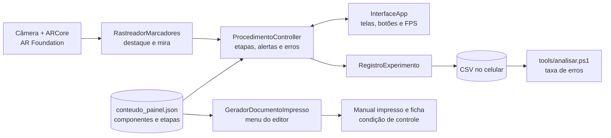

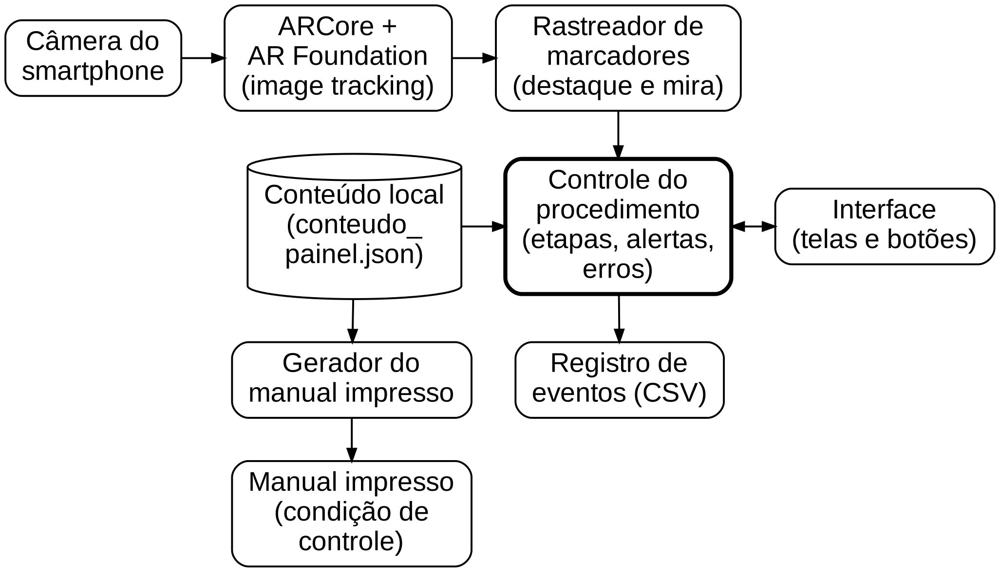

Os fontes dos diagramas estão em `docs/diagrams/`.

### Fluxo resumido

```text
Participante
   ↓
InterfaceApp (telas e botões)
   ↓
ProcedimentoController (etapas, alertas, contagem de erros)
   ↓                         ↓
RastreadorMarcadores    RegistroExperimento → CSV
   ↓
AR Foundation → ARCore → Câmera
   ↓
Marcadores ao lado dos componentes do painel
```

No computador, o ARCore é substituído pelo **XR Simulation**: o mesmo app roda no Play do editor sobre um painel virtual com os mesmos marcadores (Seção 16.2).

---

## 11. Funcionamento da Realidade Aumentada

### 11.1 Técnica utilizada

**Image Tracking baseado em marcadores.** Três imagens de referência, uma por componente, são cadastradas numa `XRReferenceImageLibrary` com seu tamanho físico real. A abordagem com marcadores foi escolhida por ser mais simples e adequada a uma prova de conceito em ambiente controlado do que abordagens *markerless*.

| Marcador | Componente | Tamanho |
|---|---|---|
| `marcador_DJ1` | Disjuntor geral DJ1 | 8 × 8 cm |
| `marcador_K1` | Contator K1 | 8 × 8 cm |
| `marcador_FT1` | Relé de sobrecarga FT1 | 8 × 8 cm |

As imagens são geradas por script (`Painel AR → Marcadores → Gerar imagens`), com semente fixa, muitos detalhes e nenhuma simetria. Elas não contêm o nome do componente, porque os marcadores ficam colados no painel nas duas condições do experimento. No build Android, o plugin ARCore avalia cada imagem com o `arcoreimg` e avisa quando a nota fica abaixo de 75 (mínimo recomendado pelo Google): não houve aviso, ou seja, as três têm nota ≥ 75. O valor exato de cada nota não aparece no log. A folha para impressão em tamanho real está em `docs/impressao/marcadores_para_imprimir.pdf`.

### 11.2 Fluxo técnico

1. O aplicativo inicia a câmera e a sessão ARCore.
2. O `ARTrackedImageManager` compara continuamente a imagem da câmera com a biblioteca de marcadores.
3. Quando um marcador é reconhecido, o `RastreadorMarcadores` cria sobre ele uma placa semitransparente e um rótulo 3D com o nome do componente.
4. O componente pedido na etapa atual fica destacado em laranja; os demais, em azul.
5. A cada quadro, o aplicativo calcula qual marcador visível está mais próximo da mira, posicionada no meio da tela na horizontal e um pouco acima do centro.
6. O participante toca em **Confirmar componente**; o aplicativo compara o componente indicado com o pedido na etapa, registra o resultado e avança, sem informar ao participante se acertou.

### 11.3 Elementos virtuais

- placa colorida sobre cada marcador reconhecido;
- rótulo 3D com o nome do componente, sempre voltado para a câmera;
- destaque do componente da etapa atual;
- mira um pouco acima do centro da tela, que fica verde quando há um componente sob ela;
- cartão com nome, função e alerta do componente na mira;
- tela de alerta de segurança antes das etapas críticas;
- indicador de progresso (etapa X de 15) e contador de FPS.

### 11.4 Registro do experimento

Cada sessão gera um arquivo `P01_RA_A_AAAAMMDD_HHMMSS.csv` (participante, condição, conjunto, data e hora) na pasta do aplicativo no celular (`Android/data/br.edu.facens.painelar/files`), gravado linha a linha para não perder dados em caso de falha. O CSV tem uma coluna com o conjunto usado e registra a versão do conteúdo no evento `SESSAO_INICIO`.

No Android 11 ou superior, essa pasta não aparece no gerenciador de arquivos do celular. Para copiar os CSVs, ligue o celular no computador pelo cabo, em modo de transferência de arquivos, e abra a pasta pelo Windows Explorer, ou use `adb pull /sdcard/Android/data/br.edu.facens.painelar/files/ C:\AR\dados`.

| Evento | Quando é registrado |
|---|---|
| `SESSAO_INICIO` / `SESSAO_FIM` | Início da sessão / fim da etapa 15, com acertos, erros e taxa |
| `ETAPA_INICIO` | Início de cada etapa |
| `ALERTA_EXIBIDO` / `ALERTA_CONFIRMADO` | Tela de alerta aparece / participante confirma a leitura |
| `MARCADOR_VISIVEL` | Um marcador passa a ser visto pela câmera |
| `INFO_EXIBIDA` | Um componente fica pelo menos 0,3 s na mira e suas informações aparecem |
| `IDENTIFICACAO` | Participante confirma um componente (`correto` = 1 ou 0) |
| `CONFIRMACAO_SEM_MARCADOR` | Toque em Confirmar sem marcador na mira (não conta como identificação) |
| `CONFIRMACAO_BLOQUEADA` | Toque em Confirmar antes de a mira ficar 0,5 s parada sobre o mesmo marcador (não conta como identificação; `componente_indicado` mostra o marcador que estava na mira) |

**Taxa de erros (%) = identificações incorretas ÷ 15 × 100**, com 15 identificações por participante (3 componentes × 5 etapas).

### 11.5 Condição de controle e análise dos dados

Os materiais da condição de documentação impressa são gerados do mesmo `conteudo_painel.json` do aplicativo (RNF07):

| Material | Arquivo |
|---|---|
| Manual impresso (foto do painel, componentes e as 15 etapas), um por conjunto | `docs/impressao/Documentacao_Impressa_A.pdf` e `Documentacao_Impressa_B.pdf` |
| Ficha de observação do pesquisador (com gabarito; não entregar ao participante), uma por conjunto | `docs/impressao/Ficha_Observacao_Papel_A.pdf` e `Ficha_Observacao_Papel_B.pdf` |
| Modelo de CSV da condição papel, com as mesmas colunas do app, um por conjunto | `docs/analise/modelo_papel_A.csv` e `modelo_papel_B.csv` |

A foto do painel usada no manual (`docs/impressao/foto_painel.jpg`) foi gerada a partir do painel virtual.

O script `tools/analisar.ps1` lê todos os CSVs de uma pasta (os do app e os da condição papel) e gera `resumo.csv` (acertos, erros, taxa e tempo por participante e condição) e `comparativo.csv` (RA e papel lado a lado). A análise é descritiva, sem teste de significância. Passo a passo em `docs/ANALISE.md`.

**Conjuntos A e B e rodízio.** Para reduzir o efeito de aprendizagem entre as duas condições, cada participante faz a RA com um conjunto de etapas e o papel com o outro. Os dois conjuntos usam os **mesmos 3 componentes**, com 5 etapas para cada um e alertas nas mesmas etapas (1, 3, 6 e 15), mas em **ordens diferentes**:

| Conjunto | Ordem dos componentes nas 15 etapas |
|---|---|
| A | DJ1 DJ1 DJ1 K1 FT1 K1 FT1 K1 FT1 DJ1 K1 FT1 FT1 K1 DJ1 |
| B | DJ1 DJ1 DJ1 FT1 K1 K1 K1 FT1 DJ1 FT1 K1 FT1 K1 FT1 DJ1 |

Ao carregar o conteúdo, o `ConteudoPainel` confere se os dois conjuntos são equivalentes e acusa erro se não forem. A tela inicial sugere o conjunto pelo número do participante:

| Participante | Primeira condição | Segunda condição |
|---|---|---|
| P01 | RA, conjunto A | Papel, conjunto B |
| P02 | Papel, conjunto B | RA, conjunto A |
| P03 | RA, conjunto B | Papel, conjunto A |
| P04 | Papel, conjunto A | RA, conjunto B |

Como os componentes são os mesmos nos dois conjuntos, o efeito de aprendizagem é reduzido, mas não eliminado (Seção 24). O `analisar.ps1` mostra os conjuntos usados, a taxa de erros por conjunto e avisa quando um participante repete o mesmo conjunto.

Os instrumentos de percepção do estudo piloto (Termo de Consentimento, questionário de caracterização, SUS e perguntas abertas) foram elaborados pela equipe e são descritos no artigo científico.

**Coleta remota.** Sem acesso a um painel físico, a coleta foi feita a distância e sem acompanhamento: cada participante recebeu o APK, a imagem do painel virtual (para abrir em tela cheia no computador, conferindo com uma régua o tamanho dos marcadores), o manual em PDF e a ordem das condições; aceitou o Termo de Consentimento por mensagem; usou o próprio celular; e respondeu a um Google Forms. Na condição papel, registrou a posição do marcador apontado em cada etapa (E, C ou D), e não o nome do componente, para a resposta não poder ser copiada do manual.

---

## 12. Estrutura do Projeto

```text
painel-ar/
│
├── Assets/
│   ├── Editor/
│   │   ├── PainelARSetup.cs
│   │   ├── PainelARSimulacao.cs
│   │   ├── GeradorMarcadores.cs
│   │   ├── GeradorDocumentoImpresso.cs
│   │   ├── CapturaTelas.cs
│   │   └── TesteSimulacao.cs
│   ├── Markers/
│   │   ├── marcador_DJ1.png
│   │   ├── marcador_K1.png
│   │   └── marcador_FT1.png
│   ├── ReferenceImages/
│   │   └── PainelReferenceImageLibrary.asset
│   ├── Resources/
│   │   └── conteudo_painel.json
│   ├── Scenes/
│   │   └── WL03ContextualAR.unity
│   ├── Scripts/
│   │   ├── ConteudoPainel.cs
│   │   ├── InterfaceApp.cs
│   │   ├── ProcedimentoController.cs
│   │   ├── RastreadorMarcadores.cs
│   │   └── RegistroExperimento.cs
│   ├── Simulacao/
│   │   ├── AmbientePainel.prefab
│   │   └── Materiais/
│   └── XR/
│
├── Packages/
├── ProjectSettings/
│
├── docs/
│   ├── analise/
│   ├── diagrams/
│   ├── documents/
│   ├── images/
│   ├── impressao/
│   ├── testes/
│   ├── ANALISE.md
│   ├── MARCADORES.md
│   └── TESTE_NO_PC.md
│
├── tools/
│   ├── unity.ps1
│   └── analisar.ps1
│
├── .gitignore
├── CHANGELOG.md
└── README.md
```

### Pastas principais

| Pasta | Finalidade |
|---|---|
| `Assets/Scripts` | Scripts da aplicação produzidos pela equipe |
| `Assets/Editor` | Ferramentas do editor (menu **Painel AR**); não vão para o APK |
| `Assets/Resources` | Arquivo de conteúdo lido pelo app em tempo de execução |
| `Assets/Markers` | Imagens dos marcadores impressos |
| `Assets/ReferenceImages` | Biblioteca de marcadores usada pelo ARCore |
| `Assets/Scenes` | Cena principal de RA (o nome `WL03ContextualAR` foi herdado do projeto-base) |
| `Assets/Simulacao` | Painel virtual usado pelo XR Simulation no computador (gerado por script) |
| `docs/impressao` | Marcadores, manuais impressos e fichas de observação dos conjuntos A e B, e foto do painel |
| `docs/analise` | Modelos de CSV da condição papel (conjuntos A e B) |
| `docs/testes` | Planilha dos testes técnicos (`Testes_Tecnicos.xlsx`) e CSVs das sessões de teste (`sessoes/`) |
| `docs/diagrams` | Diagramas de arquitetura, fluxo e caso de uso (fontes Mermaid e imagem da arquitetura) |
| `docs/documents` | Artigo científico, inventário de artigos e instrumentos de coleta |
| `docs/images` | Screenshots e fotos |
| `tools` | Scripts de linha de comando (Unity em modo batch e análise dos dados) |

Pastas `Library/`, `Temp/`, `Logs/`, `UserSettings/` e `Builds/` (onde fica o APK) não vão para o Git. O `CHANGELOG.md` resume a evolução do projeto a partir do histórico de commits.

---

## 13. Principais Scripts

| Script | Responsabilidade |
|---|---|
| `ConteudoPainel.cs` | Lê `conteudo_painel.json`, valida que toda etapa aponta para um componente existente e que os conjuntos A e B são equivalentes |
| `RastreadorMarcadores.cs` | Recebe os marcadores do AR Foundation, desenha destaque e rótulo e informa qual está na mira |
| `ProcedimentoController.cs` | Controla as fases da sessão (início, alerta, identificação, conclusão), o conjunto e o rodízio, e conta acertos e erros |
| `InterfaceApp.cs` | Desenha as telas, a barra de progresso, os cartões, a mira, os botões e o contador de FPS |
| `RegistroExperimento.cs` | Grava cada evento em uma linha do CSV da sessão |
| `PainelARSetup.cs` (editor) | Menus **Configurar projeto**, **Validar projeto** e **Gerar APK**: nome e pacote do app, montagem da cena, validação do JSON contra a biblioteca de marcadores e build |
| `GeradorMarcadores.cs` (editor) | Gera as imagens dos marcadores e a `PainelReferenceImageLibrary` |
| `PainelARSimulacao.cs` (editor) | Liga o XR Simulation no Play do editor e gera o painel virtual com DJ1, K1, FT1 e os marcadores |
| `GeradorDocumentoImpresso.cs` (editor) | Gera, a partir do mesmo JSON, o manual impresso, a foto do painel e a ficha de observação com o modelo de CSV, um conjunto de arquivos para A e outro para B |
| `CapturaTelas.cs` (editor) | Menu **Painel AR → Capturar telas do app**: gera as capturas das telas em `docs/images` |
| `TesteSimulacao.cs` (editor) | Teste automático de uma sessão completa de 15 etapas no XR Simulation, com conferência do CSV |

---

## 14. Dependências

```text
com.unity.xr.arfoundation   6.6.2
com.unity.xr.arcore         6.6.2
com.unity.xr.management     4.7.0
com.unity.inputsystem       1.20.1  (dependência do AR Foundation)
```

Render pipeline: Built-in. A interface usa IMGUI e `TextMesh`, sem dependência de TextMeshPro. Active Input Handling: **Both** (Input Manager + Input System), exigido pela navegação do XR Simulation.

---

## 15. Configuração do Ambiente

### Pré-requisitos

- Windows 10 ou 11, 64 bits;
- Unity Hub;
- Unity **6000.6.7f1** com **Android Build Support**, **OpenJDK** e **Android SDK & NDK Tools**;
- Git;
- smartphone Android compatível com ARCore, com **Google Play Services for AR** instalado, modo desenvolvedor e depuração USB ativos.

### Procedimento

1. Instale o Unity Hub e o Unity 6000.6.7f1 com os módulos Android.
2. Instale o Git.
3. Clone o repositório em um caminho curto, sem espaços nem acentos (por exemplo `C:\AR\`).
4. Abra o projeto pelo Unity Hub e aguarde a importação.
5. Rode **Painel AR → Validar projeto** e confira `[PainelAR] VALIDACAO OK` no Console. A validação confere a cena, o ARCore na aba Android, o nome do pacote e se cada marcador do JSON existe na `PainelReferenceImageLibrary`.

---

## 16. Como Executar

```bash
git clone https://github.com/KauanHYT/UPX8---Painel-Eletrico.git
cd UPX8---Painel-Eletrico
```

### 16.1 No smartphone

1. Abra o Unity Hub e clique em **Add → Add project from disk**.
2. Selecione a pasta clonada e confirme a versão 6000.6.7f1.
3. Conecte o smartphone com depuração USB ativa.
4. Use **Painel AR → Gerar APK e instalar no celular**. Para só gerar o arquivo, use **Painel AR → Gerar APK**; o APK fica em `Builds/PainelAR.apk`.

Também é possível gerar o APK pela linha de comando, com o Unity fechado:

```bash
powershell -ExecutionPolicy Bypass -File tools\unity.ps1 GerarApk
```

O script já usa uma pasta temporária curta (`C:\AR\tmp`), necessária para o Gradle (Seção 29).

### 16.2 No computador, sem smartphone (XR Simulation)

1. Abra o projeto e clique em **Play**.
2. Segure o botão direito do mouse e use **W A S D** para andar pelo painel virtual (**E**/**Q** sobem e descem); clique nos botões do app com o botão esquerdo.

Passo a passo completo em `docs/TESTE_NO_PC.md`. Quando a biblioteca de marcadores mudar, gere o painel virtual de novo em **Painel AR → Simulação → Configurar simulação no PC**.

### 16.3 Documentação impressa

**Painel AR → Gerar documentação impressa** cria `docs/impressao/Documentacao_Impressa_A.html` e `_B.html` (impressão pelo navegador). **Painel AR → Gerar ficha de observação (papel)** cria a ficha do pesquisador e o modelo de CSV. **Painel AR → Gerar foto do painel (simulação)** renderiza a foto do painel virtual.

---

## 17. Como Utilizar a Aplicação

1. Abra o **Painel AR** no smartphone e autorize o acesso à câmera.
2. Escolha o código do participante (P01, P02…) com os botões **−** e **+** e confira o conjunto de etapas (A ou B), que o app sugere pelo rodízio.
3. Toque em **Iniciar sessão**.
4. Quando aparecer a tela de alerta, leia e toque em **Li e entendi**.
5. Leia a instrução da etapa e aponte a mira para o marcador do componente pedido (destacado em laranja). A mira deve ficar sobre o **marcador** colado ao lado do componente, e não sobre o componente.
6. Confira o nome em **Na mira** e toque em **Confirmar componente**.
7. Repita até a etapa 15. A tela final mostra acertos, erros, taxa de erros, tempo e o caminho do arquivo CSV.
8. Toque em **Próximo participante** para iniciar uma nova sessão.

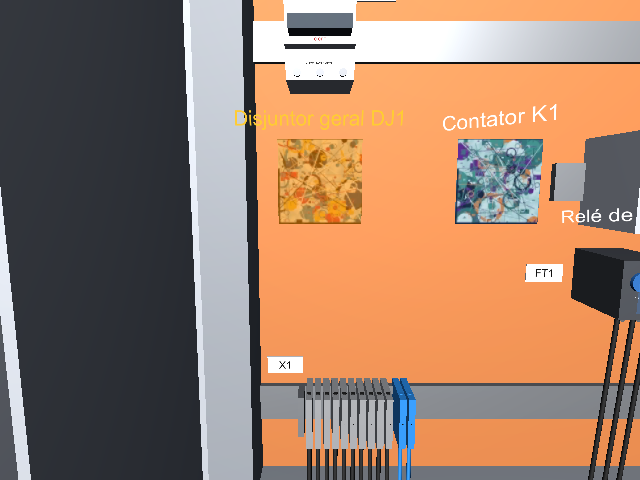

---

## 18. Fluxo de Funcionamento

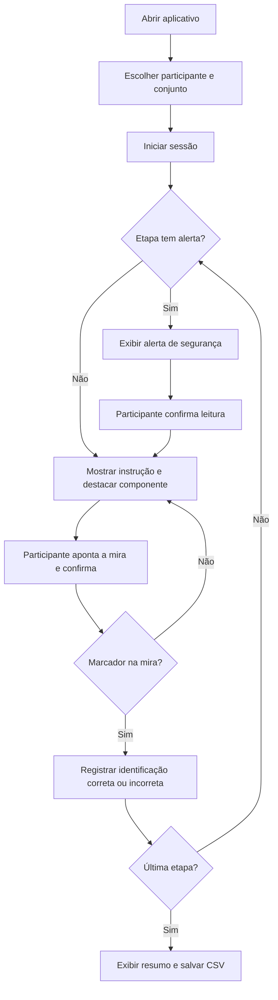

---

## 19. Caso de Uso

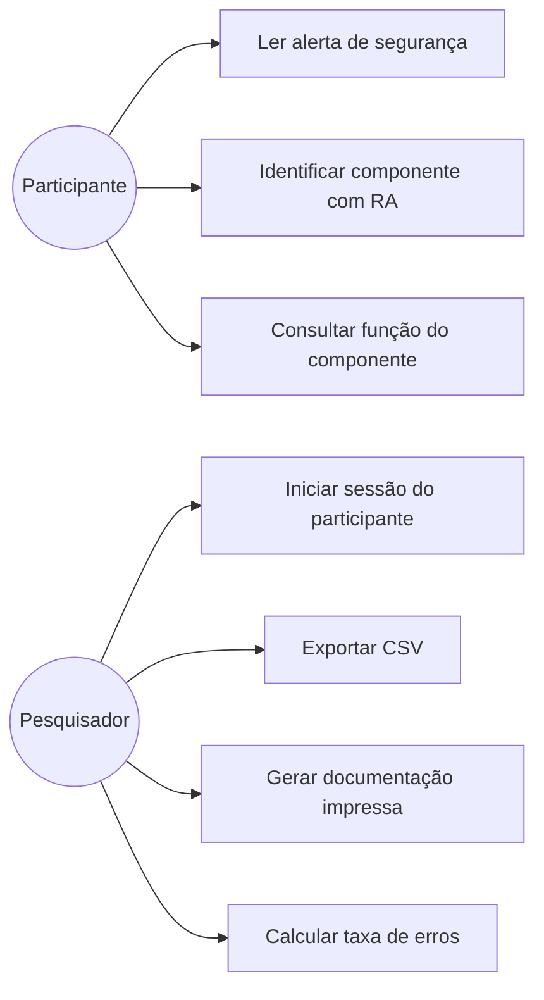

---

## 20. Fluxo de Navegação

```text
Tela Inicial (participante e conjunto)
    ↓
Alerta de Segurança (quando a etapa tem alerta)
    ↓
Etapa: instrução + mira + componente na mira
    ↓  (repete 15 vezes)
Resumo da Sessão
    ↓
Próximo Participante → Tela Inicial
```

---

## 21. Interface

Telas atuais do aplicativo, geradas por **Painel AR → Capturar telas do app** no XR Simulation (por isso o contador mostra mais de 200 FPS, valor do computador):

| Tela inicial | Alerta de segurança | Etapa com o componente na mira | Etapa sem componente na mira | Resumo da sessão |
|---|---|---|---|---|
| 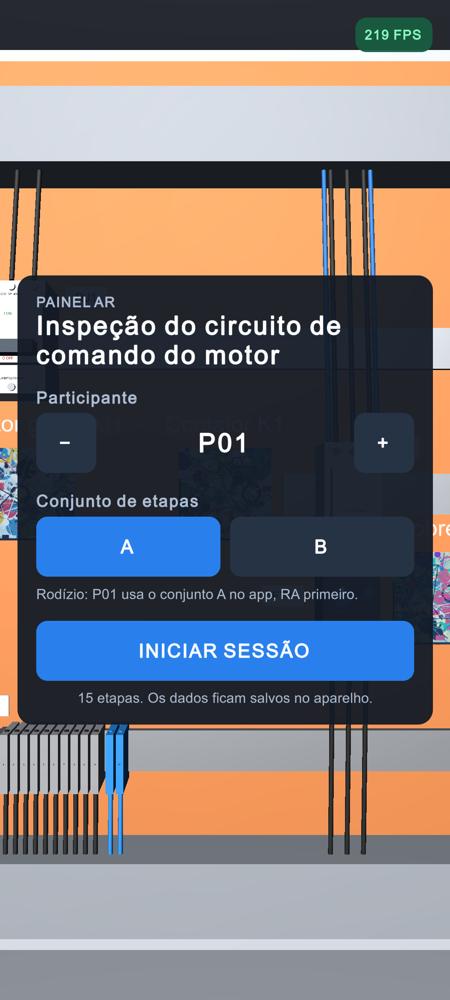 | 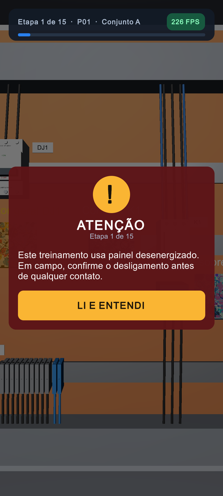 | 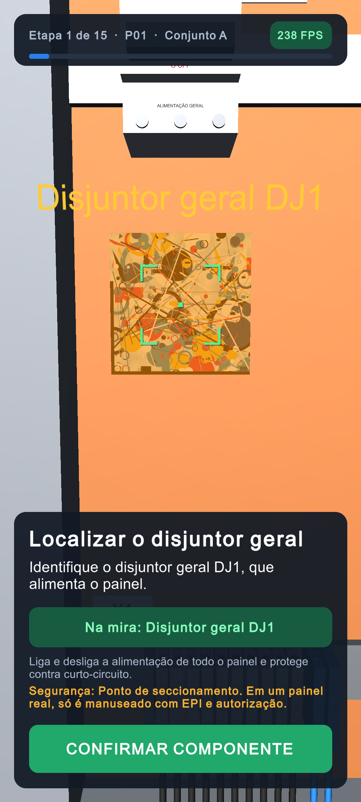 | 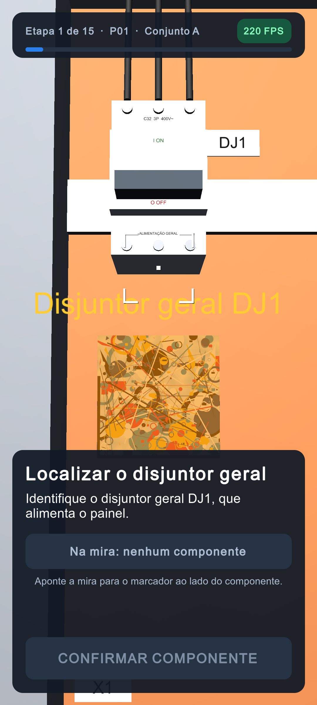 | 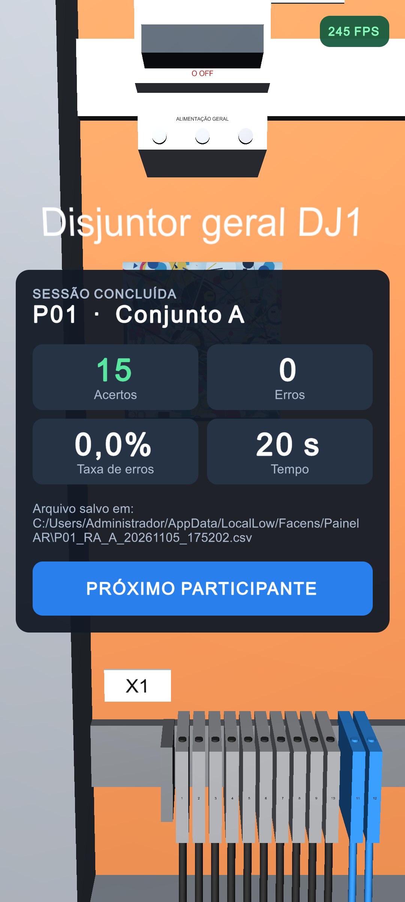 |

Capturas do teste preliminar no smartphone (27/10/2026), com a versão anterior das telas e os marcadores exibidos na tela do computador (Seção 22.2):

| Etapa com o componente na mira | Alerta de segurança | Resumo da sessão |
|---|---|---|
| 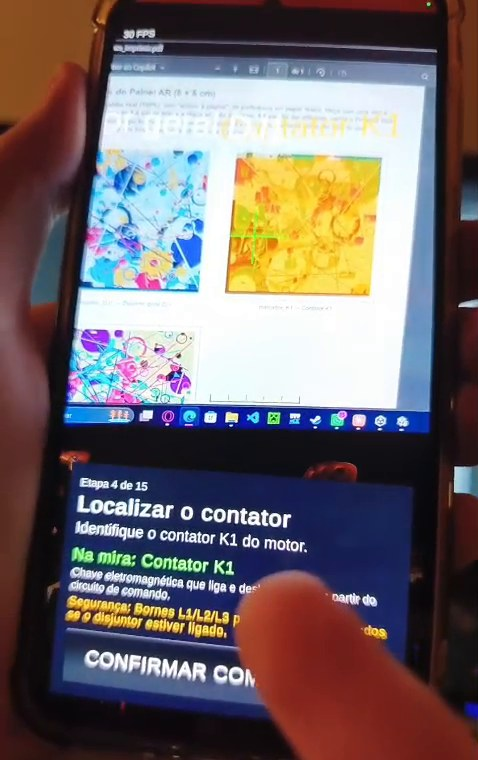 | 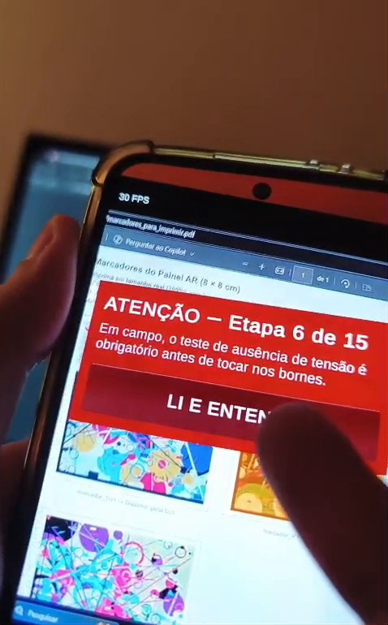 | 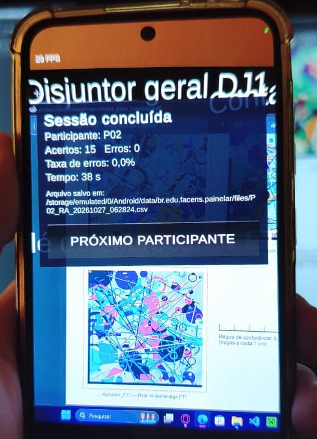 |

Também estão em `docs/images/` as capturas do painel virtual na simulação (`simulacao-painel.png`, `simulacao-painel-mira.png` e `simulacao-etapa.png`).

Telas do aplicativo:

| Tela | Finalidade | Principais elementos | Ação do usuário |
|---|---|---|---|
| Inicial | Identificar a sessão | Título do procedimento, código do participante (P01…), botões − e +, botões dos conjuntos A e B, aviso do rodízio, Iniciar sessão | Escolher o código, conferir o conjunto e iniciar |
| Alerta de segurança | Exibir o alerta antes das etapas críticas | Painel vermelho com o número da etapa e o texto do alerta, botão Li e entendi | Ler e confirmar |
| Etapa | Conduzir a identificação | Barra de progresso com etapa, participante e conjunto, mira, destaque laranja no marcador pedido, título e instrução da etapa, cartão Na mira com nome, função e alerta, botão Confirmar componente, contador de FPS | Apontar a mira para o marcador e confirmar |
| Resumo | Encerrar a sessão | Participante e conjunto, acertos, erros, taxa de erros, tempo e caminho do CSV, botão Próximo participante | Passar ao próximo participante |

Botão de confirmação depois da correção pós-piloto (Seção 22.4), em quadros de um vídeo gravado no smartphone: o botão enche de verde enquanto a mira fica parada e só libera a confirmação após 0,5 s.

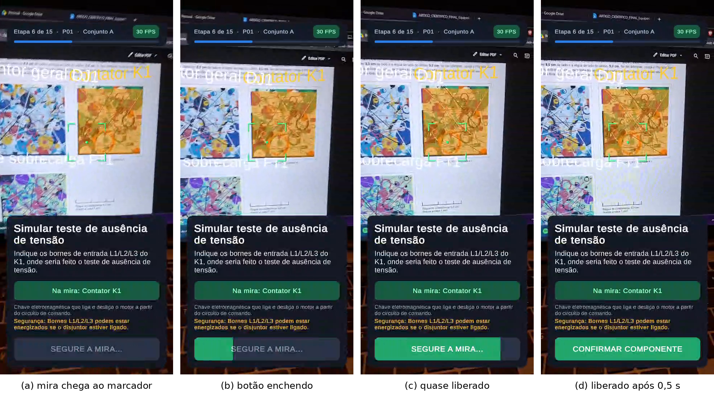

| Toque antes da liberação |
|---|
| 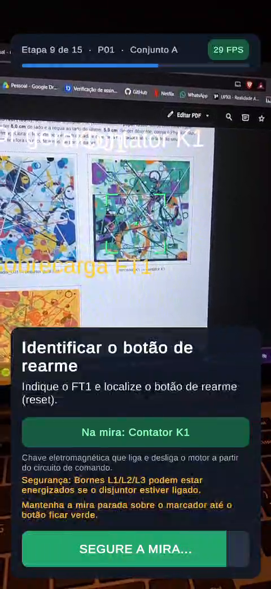 |

Captura a adicionar: foto do painel virtual em tela com os marcadores impressos fixados.

---

## 22. Testes Técnicos

### 22.1 Testes realizados no computador (XR Simulation)

| Teste | Procedimento | Resultado obtido | Status |
|---|---|---|---|
| Validação do projeto | **Painel AR → Validar projeto** | `VALIDACAO OK` | ✅ |
| Compilação Android | **Painel AR → Gerar APK** | APK gerado sem erros | ✅ |
| Qualidade dos marcadores | Avaliação do arcoreimg durante o build | Nenhum marcador abaixo de 75 | ✅ |
| Reconhecimento | Câmera virtual a 75 cm do painel | 3 de 3 marcadores reconhecidos | ✅ |
| Associação correta | Mira em cada marcador pedido | Componente correto nas 15 etapas | ✅ |
| Procedimento e registro | Sessão automática de 15 etapas com erros propositais nas etapas 4 e 12 | 13 acertos, 2 erros, taxa de 13,3%; CSV com 15 linhas `IDENTIFICACAO` e `correto = 0` só nas etapas 4 e 12 | ✅ |

O teste automático pode ser repetido com o Unity fechado:

```bash
powershell -ExecutionPolicy Bypass -File tools\unity.ps1 TesteSimulacao.Executar -SemSair
```

A simulação verifica a lógica do aplicativo, mas não processa a imagem da câmera. Por isso não substitui os testes abaixo.

### 22.2 Teste preliminar no smartphone (27/10/2026)

Teste feito pela equipe no Samsung Galaxy A56 5G, com os marcadores exibidos na tela do computador (arquivo de impressão aberto no monitor), e não impressos nem colados no painel. Não houve participantes: os códigos P01 e P02 foram usados só para teste.

| Verificação | Resultado observado | Status |
|---|---|---|
| Instalação e execução do APK | O aplicativo foi instalado, abriu a câmera e iniciou a sessão | ✅ |
| Reconhecimento e associação | Os 3 marcadores foram reconhecidos na tela; o cartão **Na mira** mostrou o componente correspondente | ✅ |
| Alertas de segurança | Alertas exibidos antes das etapas críticas (por exemplo, etapas 6 e 15) | ✅ |
| Sessões completas | 2 sessões de 15 etapas sem travamento: P01 com 10 acertos, 5 erros (33,3 %) e 163 s; P02 com 15 acertos, 0 erros (0,0 %) e 38 s | ✅ |
| Registro de dados | CSV salvo no armazenamento do app (por exemplo, `P02_RA_20261027_062824.csv`) | ✅ |
| Desempenho | 27 a 30 FPS no contador da tela | ✅ |

Observação: com os marcadores na tela do monitor, o tamanho real deles não é de 8 cm. Por isso, os rótulos 3D apareceram maiores e deslocados (por exemplo, "Disjuntor geral DJ1" no topo da tela de resumo). O posicionamento dos rótulos precisa ser conferido com os marcadores impressos no tamanho correto.

### 22.3 Testes técnicos no smartphone

Os critérios foram definidos antes da execução, conforme a Seção 3.9 do artigo. Os testes foram feitos ao longo do desenvolvimento, depois do teste preliminar da Seção 22.2. Como não foi possível usar um painel físico, foram feitos **remotamente** pelos integrantes, com o painel virtual do projeto exibido na tela de um computador e os **marcadores impressos em 8 × 8 cm** fixados ao lado de cada componente.

As tentativas não foram registradas de forma padronizada por condição: um integrante fez 7 tentativas, e os demais fizeram tentativas adicionais, somando pelo menos 10 no total. A iluminação foi variada nas condições disponíveis em casa, sem medição de luz. Por isso, os resultados de reconhecimento são observações da equipe, não contagens por condição. A planilha `docs/testes/Testes_Tecnicos.xlsx` traz o modelo para a contagem detalhada.

| Teste | Procedimento previsto | Resultado esperado | Resultado obtido | Status |
|---|---|---|---|---|
| Reconhecimento por distância | 10 tentativas por marcador a 30, 50 e 80 cm | 10/10 a 30 e 50 cm; ≥ 9/10 a 80 cm | Com marcadores de 8 cm, reconhece até cerca de 40 cm; acima disso, seria preciso um marcador maior | ✅ a 30 cm · ❌ a 50 e 80 cm |
| Reconhecimento por ângulo | 10 tentativas a 50 cm, a 0°, 30° e 45° | ≥ 9/10 em cada ângulo | Reconhecimento em todos os ângulos testados, a até 40 cm | ✅ a até 40 cm |
| Iluminação | 10 tentativas a 50 cm, luz normal e reduzida | ≥ 9/10 em cada condição | Reconhecimento em todas as condições de iluminação testadas | ✅ |
| Associação correta | Mira em cada marcador, conferir nome exibido | Nenhuma associação errada | Cada marcador mostrou o componente correto; nenhuma associação errada | ✅ |
| Desempenho | Observar FPS durante uma sessão completa | Sempre ≥ 15 FPS | Nunca abaixo de 15 FPS | ✅ |
| Estabilidade | 3 sessões completas seguidas | Nenhum travamento ou reinício | 3 sessões completas no conjunto A, sem travamento nem reinício | ✅ |
| Operação offline | 1 sessão em modo avião | Sessão completa | Sessão completa em modo avião | ✅ |
| Registro de dados | Conferir CSVs das sessões de teste | 15 linhas `IDENTIFICACAO` por sessão; erros iguais aos provocados | Sessão com erros provocados nas etapas 4 e 12: 15 linhas `IDENTIFICACAO`, `correto = 0` só nessas etapas e resumo com 13 acertos, 2 erros e 13,3%. As outras duas sessões completas: 15 de 15 | ✅ |

Os registros das sessões anteriores foram perdidos quando o aplicativo foi desinstalado para instalar a versão nova, porque o Android apaga a pasta do aplicativo junto. Os CSVs mantidos, em `docs/testes/sessoes/`, são das sessões de conferência feitas com a versão final do aplicativo, já com os conjuntos A e B (códigos de teste, sem participantes):

| Arquivo | Conjunto | Resultado |
|---|---|---|
| `P01_RA_A_20261107_133203.csv` | A | Sessão completa: 15 acertos, 0 erros, 133,7 s |
| `P01_RA_A_20261107_134000.csv` | A | Sessão completa: 15 acertos, 0 erros, 119,2 s |
| `P01_RA_A_20261107_135514.csv` | A | Sessão completa com erros provocados nas etapas 4 e 12: 13 acertos, 2 erros (13,3%), 33,9 s |

**Consequências para o experimento:**

- com marcadores de 8 cm, o participante precisa ficar a até cerca de 40 cm dos marcadores; para distâncias maiores, é preciso imprimir marcadores maiores e atualizar o tamanho físico na biblioteca de imagens;
- as sessões de conferência usaram só o conjunto A; o conjunto B foi usado na coleta por P03 e P04 sem falhas, e na verificação da Seção 22.4;
- na coleta, cada participante usou o próprio celular, então os CSVs de teste não se misturaram aos dos participantes.

### 22.4 Verificação da correção da confirmação (pós-piloto)

No estudo piloto (Seção 25.1), os 6 erros com o app aconteceram com o aplicativo associando corretamente o marcador, mas com a confirmação feita com a mira sobre outro marcador: em 4 deles, o do componente da etapa anterior, logo depois de a etapa começar. A correção:

- o botão **Confirmar** só é liberado depois de **0,5 s** com a mira parada sobre o mesmo marcador, e enche de verde durante a espera ("SEGURE A MIRA...");
- a contagem recomeça a cada etapa, então um toque logo depois de avançar não confirma a etapa seguinte;
- o toque antes da liberação não conta como identificação: aparece o aviso "Mantenha a mira parada..." e o CSV grava `CONFIRMACAO_BLOQUEADA`;
- o tempo pode ser ajustado no Inspector, em `ProcedimentoController` → **Tempo Minimo Para Confirmar**.

Sessão de verificação com a versão corrigida, no smartphone, tocando em Confirmar logo depois de avançar a etapa e com o celular em movimento:

| Arquivo | Conjunto | Resultado |
|---|---|---|
| `P07_RA_B_20261107_205419.csv` | B | 15 acertos, 0 erros, 47,1 s; 5 toques recusados (`CONFIRMACAO_BLOQUEADA`), 3 deles 0,3 a 0,4 s após o início da etapa, com a mira no componente da etapa anterior (etapas 5, 11 e 12) |

É uma verificação técnica: mostra que o app recusa os toques prematuros, mas o efeito da correção sobre a taxa de erros ainda precisa ser avaliado com novos participantes.

---

## 23. Dispositivos Testados

| Dispositivo | Sistema | Versão | Resultado |
|---|---|---|---|
| Computador (XR Simulation no editor Unity) | Windows 11 Pro | Unity 6000.6.7f1 | Sessões completas sem falha (Seção 22.1) |
| Samsung Galaxy A56 5G (de um integrante) | Android | — | Aplicativo executado; 2 sessões completas no teste preliminar, a 27–30 FPS (Seção 22.2) |
| Smartphones Android dos integrantes, nos testes remotos | Android | — | Testes técnicos (Seção 22.3) e verificação da correção (Seção 22.4) |
| Samsung Galaxy S23, S24 e S26 e Motorola moto g53 (dos participantes) | Android | — | 4 sessões completas do estudo piloto, sem travamento nem reinício (Seção 25.1) |

---

## 24. Limitações Conhecidas

- O reconhecimento depende de iluminação adequada, papel fosco e marcadores planos e visíveis.
- Funciona apenas em aparelhos compatíveis com ARCore.
- Prova de conceito com 3 componentes e um único procedimento.
- Por ser um estudo piloto com 4 participantes, a análise é apenas descritiva, sem inferência estatística; os resultados são evidências preliminares de viabilidade.
- A coleta foi remota e sem acompanhamento: a ordem das condições não pôde ser verificada, e as respostas e o tempo da condição papel foram informados pelos próprios participantes.
- A correção da confirmação (Seção 22.4) foi verificada tecnicamente, mas ainda não foi avaliada com participantes.
- Os resultados valem para uma tarefa controlada, sem intervenção elétrica, e não devem ser generalizados para manutenção real nem interpretados como redução de acidentes.
- Mudanças no conteúdo exigem novo build, porque o JSON é empacotado dentro do APK.
- O aplicativo reconhece o **marcador** colado ao lado do componente, e não o componente: na simulação, foi natural mirar no próprio componente. As instruções padrão aos participantes precisam deixar isso claro.
- Os testes usaram um painel virtual exibido em tela, e não um painel elétrico físico. O comportamento em um painel real (reflexos, superfícies metálicas, espaço disponível e iluminação do ambiente) não foi verificado.
- Com marcadores de 8 cm, o reconhecimento funciona até cerca de 40 cm.
- Nos testes de reconhecimento, as tentativas não foram contadas por condição e a iluminação não foi medida.
- Os conjuntos A e B usam os mesmos 3 componentes, em ordens diferentes; isso reduz o efeito de aprendizagem entre as condições, mas não o elimina.
- A nota exata de cada marcador no arcoreimg não é conhecida; sabe-se apenas que ficou ≥ 75.
- Algumas instruções do conteúdo provisório não citam o componente (por exemplo, a etapa 3). No app, o destaque laranja compensa; no manual, a coluna "Componente" traz o nome.

---

## 25. Evidências de Funcionamento

Disponíveis:

- capturas do painel virtual na simulação (Seção 21);
- capturas das telas de etapa, alerta e resumo no smartphone, do teste preliminar (Seções 21 e 22.2);
- capturas das cinco telas atuais do aplicativo (Seção 21);
- foto do painel virtual com os componentes indicados (`docs/impressao/foto_painel.jpg`);
- manuais impressos, fichas de observação e folha dos marcadores em `docs/impressao/`;
- CSVs das sessões dos testes técnicos em `docs/testes/sessoes/` (Seções 22.3 e 22.4);
- quadros do vídeo da correção da confirmação (Seção 21).

Os dados dos participantes (CSVs do app e respostas do formulário) não ficam no repositório: conforme o Termo de Consentimento, são guardados em pasta de acesso restrito à equipe. Aqui ficam apenas os resultados agregados por código.

### 25.1 Resultados do estudo piloto

Quatro estudantes (P01 a P04), com o próprio celular, em coleta remota (Seção 11.5). Resultados detalhados e discussão no artigo científico.

| Indicador | P01 | P02 | P03 | P04 |
|---|---|---|---|---|
| Conjunto: app / manual | A / B | A / B | B / A | B / B (desvio) |
| Erros no app (taxa) | 2 (13,3%) | 0 (0,0%) | 1 (6,7%) | 3 (20,0%) |
| Erros no manual | 0 | 0 | 0 | 0 |
| Tempo no app (s) | 72,2 | 66,9 | 61,0 | 324,8 |
| Tempo no manual (s) | 216 | 233 | 128 | desconsiderado* |
| SUS | 80,0 | 87,5 | 87,5 | 77,5 |

\* O tempo informado para o manual (325 s) era igual ao do app e foi desconsiderado.

- **Hipótese H1** (menos erros com RA): não sustentada; o app teve mais erros que o manual em 3 participantes e o mesmo número em 1.
- **Origem dos erros:** nos 6 erros, o app associou corretamente o marcador, mas a confirmação foi feita com a mira sobre outro marcador, em 4 casos o do componente da etapa anterior. Isso levou à correção da Seção 22.4.
- **Tempo:** para P01 a P03, a tarefa com o app levou de 29% a 48% do tempo com o manual.
- **SUS:** média de 83,1.
- **Desvios:** P04 usou o conjunto B nas duas condições; P01 respondeu a uma versão anterior do formulário; a pergunta de exclusão foi mal interpretada por três participantes, que confirmaram não ter participado do desenvolvimento.

Pendentes:

- foto do painel virtual em tela com os marcadores impressos fixados;
- vídeo da experiência RA durante uma sessão completa.

Quando o vídeo de demonstração for publicado, o link será adicionado aqui.

---

## 26. Repositórios e Recursos

| Recurso | Link |
|---|---|
| Código-fonte | https://github.com/KauanHYT/UPX8---Painel-Eletrico |
| Artigo científico | `docs/documents/ARTIGO_CIENTIFICO_FINAL_Equipe4.docx` |
| Teste no computador | `docs/TESTE_NO_PC.md` |
| Marcadores | `docs/MARCADORES.md` |
| Coleta e análise dos dados | `docs/ANALISE.md` |
| Trello | https://trello.com/b/vCfj9rZ9/upx8-realidade-aumentada |

---

## 27. Cronograma Técnico

Estimativa de 6 semanas e cerca de 100 horas de trabalho da equipe.

| Atividade | Responsável | Status |
|---|---|---|
| Revisão bibliográfica | Equipe | ✅ |
| Definição do painel, componentes e procedimento | Equipe | ✅ (painel virtual, 3 componentes, conjuntos A e B; conteúdo `0.2-provisoria`) |
| Protótipos de interface | Kauan | ✅ |
| Implementação da aplicação | Enrico e Kauan | ✅ (inclui conjuntos A e B e rodízio) |
| Integração do reconhecimento de marcadores | Enrico e Kauan | ✅ (verificada no smartphone com marcadores impressos) |
| Materiais da condição papel e script de análise | Equipe | ✅ |
| Testes técnicos | Equipe | ✅ (reconhecimento até cerca de 40 cm com marcadores de 8 cm) |
| Protocolo experimental | Guilherme | ✅ (instrumentos de coleta elaborados) |
| Coleta e análise dos dados | Equipe | ✅ (4 participantes, coleta remota; Seção 25.1) |
| Correção da confirmação (pós-piloto) | Equipe | ✅ (verificada tecnicamente; Seção 22.4) |
| Versão final do artigo | Equipe | ✅ |

---

## 28. Controle de Versão

O repositório oficial é https://github.com/KauanHYT/UPX8---Painel-Eletrico. O desenvolvimento é registrado em commits pequenos, cada um com uma mudança, seguindo o padrão abaixo.

| Prefixo | Uso | Exemplo |
|---|---|---|
| `feat:` | nova funcionalidade | `feat: registra identificações em CSV` |
| `fix:` | correção | `fix: zera Camera Y Offset para o XR Simulation` |
| `docs:` | documentação | `docs: atualiza README para o estudo piloto` |
| `test:` | testes | `test: adiciona sessão automática no XR Simulation` |
| `chore:` | configuração e ferramentas | `chore: adiciona tools/unity.ps1` |

- **Branch principal:** `main`, sempre com uma versão que abre e compila no Unity 6000.6.7f1.
- **Tags previstas:** `v0.1-simulacao` (app verificado no XR Simulation), `v0.2-dispositivo` (testes técnicos no smartphone) e `v1.0-piloto` (versão usada na coleta).
- **Não versionados:** `Library/`, `Temp/`, `Logs/`, `UserSettings/`, `Builds/` e arquivos de assinatura do Android (`*.keystore`), conforme o `.gitignore`.

---

## 29. Problemas Encontrados e Soluções

### Build Android falhava no Gradle

**Sintoma:** `java.io.IOException: Unable to establish loopback connection` ao gerar o APK.

**Causa:** o Java 17 do Unity cria um socket local na pasta temporária, e a conexão falhava no caminho padrão do Windows (`C:\Users\ADMINI~1\...`).

**Solução:** usar uma pasta temporária curta (`C:\AR\tmp`). O `tools/unity.ps1` faz isso sempre.

### Marcadores não eram reconhecidos no XR Simulation

**Sintoma:** o marcador aparecia na imagem da câmera simulada, mas nunca era reconhecido.

**Causa:** o XR Origin herdado do WL03 somava 1,12 m de altura à câmera (Camera Y Offset). O simulador usa a posição da câmera com essa altura para decidir o que ela vê, mas desenha o ambiente sem ela.

**Solução:** Camera Y Offset = 0 (feito por **Painel AR → Configurar projeto**). No smartphone não muda nada, porque câmera e marcadores usam o mesmo referencial. A validação do projeto passou a conferir esse valor.

### Componentes do painel virtual apareciam pretos

**Causa:** o gerador do painel guardava os materiais só pelo tipo, e todas as peças de plástico herdavam a cor da primeira criada.

**Solução:** um material por tipo e cor.

### Foto do manual com legendas escondidas e imagem estourada

**Solução:** legendas posicionadas na frente do gabinete, iluminação reduzida na renderização e porta e bancada escondidas na foto.

### Aplicativo não executou no smartphone

**Sintoma:** o APK foi gerado, mas o aplicativo não executou no Samsung Galaxy A56 5G de um integrante.

**Causa:** a falha foi atribuída inicialmente à falta de suporte ao ARCore, mas o modelo consta na lista oficial de aparelhos compatíveis do Google.

**Solução:** resolvido. Em 27/10/2026 o aplicativo rodou no aparelho e completou duas sessões de teste (Seção 22.2).

### Marcadores não eram reconhecidos acima de cerca de 40 cm

**Sintoma:** com os marcadores impressos em 8 × 8 cm, o reconhecimento funcionou até cerca de 40 cm, mas não a 50 e 80 cm, distâncias previstas nos critérios.

**Causa:** a partir de certa distância, o marcador ocupa poucos pixels na imagem da câmera, e o ARCore não encontra pontos de referência suficientes para reconhecê-lo.

**Solução:** no experimento, o participante trabalha a até cerca de 40 cm dos marcadores. Para distâncias maiores, é preciso imprimir marcadores maiores e atualizar o tamanho físico de cada imagem na `PainelReferenceImageLibrary`.

### Erros de confirmação no estudo piloto

**Sintoma:** no estudo piloto, o app teve 6 erros em 60 identificações, enquanto o manual não teve nenhum.

**Causa:** pelo CSV, em todos os erros o cartão **Na mira** mostrava o componente confirmado, ou seja, o app associou corretamente o marcador, mas a confirmação foi feita com a mira sobre outro marcador: em 4 casos, o do componente da etapa anterior, logo depois de a etapa começar; em um deles, 0,12 s depois de a mira chegar ao marcador errado. O botão aceitava a confirmação assim que havia qualquer marcador na mira.

**Solução:** confirmação só liberada após 0,5 s de mira parada sobre o mesmo marcador, com contagem reiniciada a cada etapa e registro dos toques recusados (`CONFIRMACAO_BLOQUEADA`). Verificada na Seção 22.4.

### Comandos do Unity em linha de comando não abriam o projeto

**Causa:** o projeto estava aberto no editor, e o Unity não abre o mesmo projeto duas vezes.

**Solução:** fechar o editor antes de usar o `tools/unity.ps1`, ou usar os mesmos comandos pelo menu **Painel AR**.

---

## 30. Melhorias Futuras

- avaliar a correção da confirmação (Seção 22.4) com novos participantes;
- marcadores maiores e mais espaçados, sobretudo entre o contator K1 e o relé FT1;
- ampliar o número de componentes e procedimentos;
- carregar o conteúdo de um arquivo externo, sem precisar de novo build;
- exportar os CSVs direto pelo aplicativo (compartilhamento);
- adicionar instrumento NASA-TLX ao fim da sessão;
- avaliar rastreamento *markerless* em painéis reais;
- repetir o experimento com amostra maior para permitir análise estatística;
- modo demonstração que mostra o painel virtual em RA no smartphone, separado do modo do experimento.

---

## 31. Custos e Recursos

| Recurso | Tipo | Custo/Condição |
|---|---|---|
| Unity | Software | Licença Personal (gratuita) |
| AR Foundation / ARCore | Software | Gratuitos |
| Smartphone Android com ARCore | Hardware | Equipamento da equipe (Samsung Galaxy A56 5G) |
| Computador | Hardware | Equipamento da equipe |
| Painel virtual exibido em tela | Software | Sem custo (painel 3D do próprio projeto) |
| Impressão dos marcadores e da documentação | Material | Baixo custo |

---

## 32. Licença

Projeto acadêmico desenvolvido para fins educacionais na disciplina de UPX — Realidade Aumentada do Centro Universitário Facens. Caso a equipe adote uma licença formal de software, este texto será substituído e o arquivo `LICENSE` correspondente será incluído.

---

## 33. Autores

- **Enrico Affonso Fernandes Alves** — Desenvolvimento RA
- **Guilherme Luiz Rodrigues Ifanger** — Documentação
- **Kauan Michael de Freitas** — Desenvolvimento RA

**Instituição:** Centro Universitário Facens  
**Disciplina:** UPX — Realidade Aumentada  
**Semestre:** 2026.2
