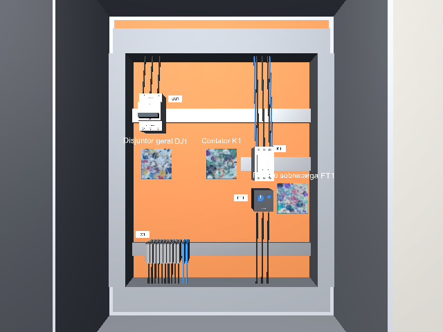
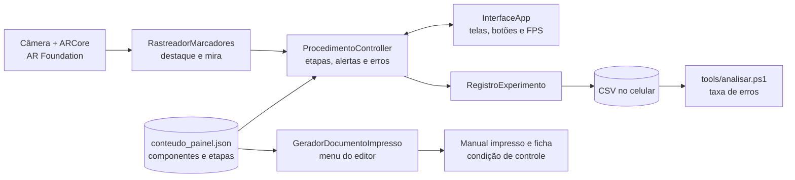
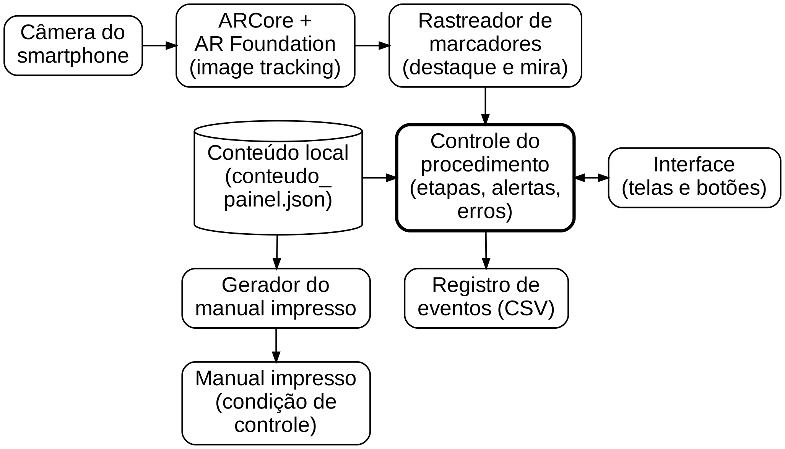
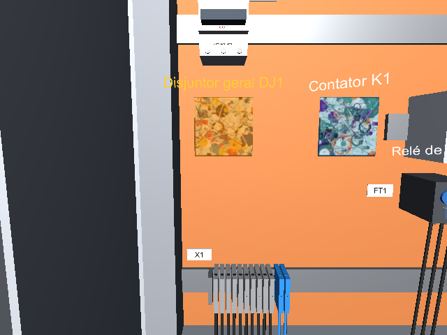
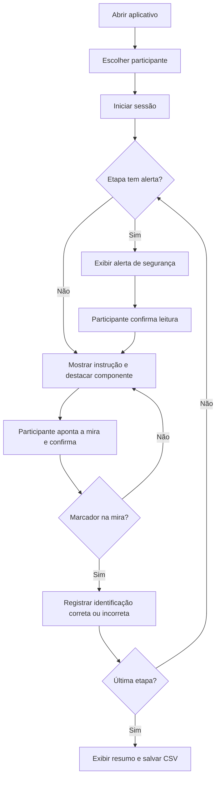
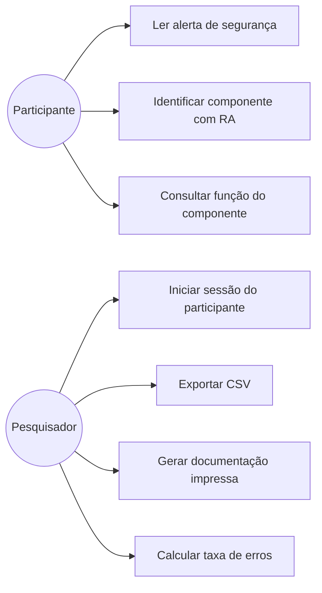
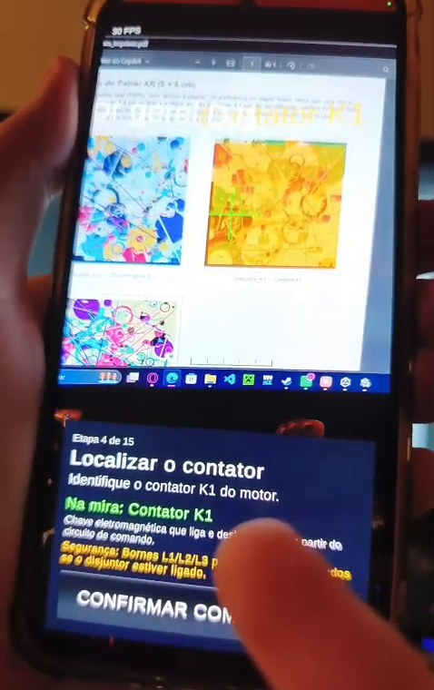
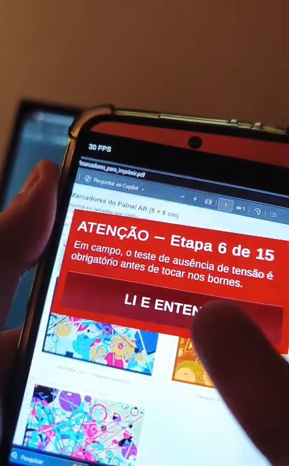
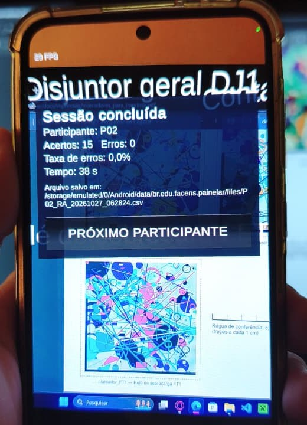

# Painel AR — Identificação de Componentes em Painéis Elétricos

> **UPX — Realidade Aumentada · Centro Universitário Facens**  
> Prova de conceito de aplicativo Android de Realidade Aumentada baseada em marcadores para apoiar a identificação de componentes e a execução guiada de um procedimento de manutenção em um painel elétrico didático desenergizado, avaliada por meio de um estudo piloto de viabilidade.


-green)


---

## 1. Identificação do Projeto

| Item | Informação |
|---|---|
| **Projeto** | Painel AR — Realidade Aumentada Baseada em Marcadores para Apoio à Identificação de Componentes e Execução de Procedimentos de Manutenção em Painéis Elétricos |
| **Equipe** | Equipe 4 |
| **Curso** | Engenharia de Computação |
| **Disciplina** | UPX — Realidade Aumentada |
| **Professor** | Daniel Ohata |
| **Semestre** | 2026.2 |
| **Instituição** | Centro Universitário Facens — Sorocaba, SP |

### Integrantes

| Nome | RA | Responsabilidade |
|---|---|---|
| Enrico Affonso Fernandes Alves | 210141 | Desenvolvimento AR |
| Guilherme Luiz Rodrigues Ifanger | 235438 | Documentação |
| Kauan Michael de Freitas | 236023 | Desenvolvimento AR |

---

## 2. Visão Geral

Operadores em treinamento e técnicos menos experientes costumam depender de manuais impressos, etiquetas ou memória para localizar o componente certo de um painel elétrico antes de um procedimento de manutenção, e um erro de identificação aumenta o risco da atividade.

Para apoiar essa identificação, o **Painel AR** é um aplicativo Android de Realidade Aumentada que reconhece marcadores impressos colados ao lado dos componentes de um painel elétrico didático. Ao apontar a câmera para um marcador, o aplicativo mostra o nome do componente, sua função e alertas de segurança, e conduz o usuário por um procedimento de manutenção simulado de 15 etapas.

O aplicativo é o instrumento da condição experimental de RA de um **estudo piloto de viabilidade**, descrito no artigo científico da equipe. Durante a tarefa, ele registra cada identificação feita pelo participante e calcula a **taxa de erros de identificação**, que é comparada com o uso de documentação impressa de conteúdo equivalente. O piloto verifica se o protocolo e o aplicativo funcionam nas condições do experimento e produz evidências preliminares, sem pretensão de demonstrar eficácia generalizável.

O estudo é feito exclusivamente em painel **desenergizado**, sem intervenção elétrica real. O conteúdo técnico será revisado por profissional da área antes do experimento; a versão atual do conteúdo (`0.1-provisoria`) **ainda não passou por essa revisão**.

> **Estado atual:** o aplicativo está implementado e foi testado no computador, num painel virtual, com o **XR Simulation** do AR Foundation (Seção 22). Em 27/10/2026 o aplicativo também **rodou no smartphone** (Samsung Galaxy A56 5G), num teste preliminar com os marcadores exibidos na tela do computador: duas sessões completas de 15 etapas, com registro em CSV (Seção 22.2). Os testes formais com marcadores impressos e o painel didático real ainda não foram feitos.



---

## 3. Problema

Atividades de manutenção elétrica expõem o trabalhador a riscos como choque elétrico e arco elétrico. Um dos fatores que pode agravar esse risco é o erro na identificação de componentes: operadores em treinamento e profissionais menos experientes costumam depender de manuais impressos, etiquetas físicas ou memorização para localizar o componente certo antes de executar um procedimento.

A RA já é aplicada em manutenção industrial, mas, nos trabalhos analisados pela equipe, não foi encontrada uma avaliação experimental que compare uma aplicação de RA real, baseada em marcadores, com documentação impressa equivalente quanto à taxa de erros de identificação em um painel elétrico físico.

**Questão de pesquisa (RQ1):** qual é o efeito do uso de uma aplicação de RA baseada em marcadores, em comparação ao uso de documentação tradicional impressa, sobre a taxa de erros de identificação de componentes durante a execução de um procedimento de manutenção em um painel elétrico didático?

**Hipótese (H1):** usuários que utilizam a aplicação de RA apresentarão menor taxa de erros na identificação dos componentes do que usuários que utilizam documentação impressa.

Por se tratar de um estudo piloto com amostra reduzida, a H1 é explorada de forma descritiva: os resultados indicam se os dados são compatíveis ou não com a hipótese, sem testá-la estatisticamente.

---

## 4. Objetivos

### 4.1 Objetivo Geral

Desenvolver e avaliar, por meio de um estudo piloto de viabilidade, uma prova de conceito de aplicação móvel de Realidade Aumentada baseada em marcadores para apoiar a identificação de componentes e a execução guiada de um procedimento de manutenção em um painel elétrico didático desenergizado.

### 4.2 Objetivos Técnicos

- Configurar um projeto Unity com AR Foundation e ARCore para Android.
- Reconhecer três marcadores impressos, cada um associado a um componente do painel.
- Exibir, sobre cada marcador, o nome do componente e um destaque visual.
- Mostrar função e alertas de segurança do componente que está na mira.
- Conduzir um procedimento de 15 etapas com alerta obrigatório antes das etapas críticas.
- Registrar em CSV, no próprio aparelho, cada evento da sessão e cada identificação (correta ou incorreta).
- Gerar a documentação impressa a partir do mesmo arquivo de conteúdo do aplicativo.
- Executar testes técnicos de reconhecimento, desempenho e estabilidade antes do experimento.

---

## 5. Público-Alvo

Operadores em treinamento, estudantes de cursos técnicos e de engenharia e profissionais menos experientes que precisam identificar componentes de um painel elétrico antes de executar um procedimento de manutenção.

No estudo piloto, participam de 2 a 4 voluntários, com registro da familiaridade prévia de cada um com componentes e procedimentos de manutenção elétrica (campo da ficha de observação, Seção 11.5). Cada participante realiza as duas condições (RA e documentação impressa), com a ordem alternada entre participantes. Os critérios de inclusão e exclusão serão definidos no protocolo experimental.

Materiais complementares (perfil dos participantes, termo de consentimento, protocolo do experimento) ficam em `docs/documents/`.

---

## 6. Funcionalidades

| ID | Funcionalidade | Descrição | Status | Verificado em |
|---|---|---|---|---|
| RF01 | Acessar o painel pela câmera | Abre a câmera em modo RA e inicia a sessão do participante | ✅ | Simulação no PC |
| RF02 | Reconhecer marcadores | Reconhece os 3 marcadores cadastrados na Reference Image Library | ✅ | Simulação no PC |
| RF03 | Identificar o componente | O participante aponta a mira para um marcador e confirma | ✅ | Simulação no PC |
| RF04 | Conhecer o componente | Mostra nome, função e alerta do componente na mira | ✅ | Simulação no PC |
| RF05 | Agir com segurança | Exibe alerta obrigatório antes das etapas críticas | ✅ | Simulação no PC |
| RF06 | Seguir o procedimento | Conduz as 15 etapas e destaca o componente pedido | ✅ | Simulação no PC |
| RF07 | Medir o desempenho | Grava um CSV por participante com todos os eventos | ✅ | Simulação no PC |
| RF08 | Medir o erro | Conta identificações incorretas e calcula a taxa de erros | ✅ | Simulação no PC |

**Legenda:** ✅ Implementado · 🚧 Em desenvolvimento · ⬜ Planejado · ❌ Cancelado

Todas as funcionalidades estão implementadas e foram verificadas no computador com o XR Simulation (Seção 22.1). No smartphone, foram verificadas num teste preliminar com os marcadores exibidos na tela do computador (Seção 22.2); os testes formais estão na Seção 22.3. Os conjuntos A e B, o SUS e a entrevista do estudo piloto estão planejados (Seção 11.5).

---

## 7. Requisitos Não Funcionais

| ID | Categoria | Requisito | Situação |
|---|---|---|---|
| RNF01 | Plataforma | Executar em smartphones Android compatíveis com ARCore, sem acessórios adicionais | APK Android (ARM64, IL2CPP, ARCore obrigatório) instalado e executado no Samsung Galaxy A56 5G |
| RNF02 | Qualidade de rastreamento | Reconhecer corretamente os marcadores nas condições de iluminação, distância e ângulo do experimento, sem falsos reconhecimentos | Marcadores com nota ≥ 75 no arcoreimg; testes no celular pendentes |
| RNF03 | Desempenho | Manter o rastreamento utilizável durante a tarefa, com referência inicial de 15 FPS | Contador de FPS na tela; 27 a 30 FPS no teste preliminar no celular; medição formal pendente |
| RNF04 | Estabilidade | Completar uma sessão experimental sem falhas que exijam reinício da aplicação | Sessões completas na simulação; CSV gravado a cada evento |
| RNF05 | Disponibilidade | Operar sem conexão com a internet, com o conteúdo armazenado localmente | Conteúdo empacotado no APK; teste em modo avião pendente |
| RNF06 | Usabilidade | Textos legíveis à distância de uso e operação com uma das mãos | Fonte proporcional à tela e botões grandes na parte de baixo |
| RNF07 | Equivalência de conteúdo | Gerar a documentação impressa e o conteúdo do aplicativo a partir da mesma fonte de dados | App, manual impresso e ficha gerados do mesmo `conteudo_painel.json` |
| RNF08 | Segurança e privacidade | Uso restrito ao painel didático desenergizado, conteúdo revisado por profissional e dados dos participantes anonimizados | Participantes só por código (P01…); revisão técnica pendente |

---

## 8. Tecnologias Utilizadas

| Tecnologia | Versão | Utilização |
|---|---|---|
| Unity | 6000.6.7f1 | Desenvolvimento principal (licença Personal) |
| C# | compatível com Unity 6.6 | Scripts da aplicação e do editor |
| AR Foundation | 6.6.2 | Camada de abstração de RA (image tracking) |
| Google ARCore XR Plugin | 6.6.2 | Recursos de RA no Android |
| XR Plugin Management | 4.7.0 | ARCore no Android e XR Simulation no PC |
| XR Simulation (AR Foundation) | 6.6.2 | Testes no computador com painel virtual |
| Input System | 1.20.1 | Navegação no XR Simulation (projeto em modo "Both") |
| Android SDK/NDK + OpenJDK 17 | instalados pelo Unity Hub | Build Android (IL2CPP, ARM64, Android 8.0 ou superior) |
| arcoreimg (incluso no ARCore XR Plugin) | — | Avaliação da qualidade das imagens dos marcadores durante o build |
| PowerShell 5.1 | — | Automação do Unity (`tools/unity.ps1`) e análise dos dados (`tools/analisar.ps1`) |
| Git / GitHub | 2.x / — | Controle de versão e documentação |

> Base técnica: projeto *white label* **WL03 — Contextual AR** da disciplina, adaptado para múltiplos marcadores e registro experimental. O WL03 foi feito no Unity 6.3; ao abrir no 6.6, os pacotes foram atualizados automaticamente para 6.6.2.

---

## 9. Hardware Utilizado

| Equipamento | Modelo | Característica relevante | Utilização |
|---|---|---|---|
| Smartphone | Samsung Galaxy A56 5G (de um integrante) | Android; consta na lista oficial de aparelhos compatíveis com ARCore | Execução, testes e experimento (app executado em 27/10/2026) |
| Computador | MSI MS-7E06 | Windows 11 Pro, Intel Core i7-13700, 32 GB de RAM, NVIDIA GeForce RTX 4060 | Desenvolvimento, simulação e build |
| Painel elétrico didático | Painel do laboratório da instituição (modelo a confirmar) | Desenergizado, com disjuntor, contator e relé de sobrecarga | Cenário do experimento |
| Marcadores impressos | — | 3 imagens de 8 × 8 cm, papel fosco | Referências de rastreamento |

---

## 10. Arquitetura do Sistema

A solução é organizada em captura da imagem, reconhecimento de marcadores, identificação do componente (consulta à base local), apresentação de informações e registro dos eventos da tarefa experimental.





Os fontes dos diagramas estão em `docs/diagrams/`.

### Fluxo resumido

```text
Participante
   ↓
InterfaceApp (telas e botões)
   ↓
ProcedimentoController (etapas, alertas, contagem de erros)
   ↓                         ↓
RastreadorMarcadores    RegistroExperimento → CSV
   ↓
AR Foundation → ARCore → Câmera
   ↓
Marcadores no painel didático
```

No computador, o ARCore é substituído pelo **XR Simulation**: o mesmo app roda no Play do editor sobre um painel virtual com os mesmos marcadores (Seção 16.2).

---

## 11. Funcionamento da Realidade Aumentada

### 11.1 Técnica utilizada

**Image Tracking baseado em marcadores.** Três imagens de referência, uma por componente, são cadastradas numa `XRReferenceImageLibrary` com seu tamanho físico real. A abordagem com marcadores foi escolhida por ser mais simples e adequada a uma prova de conceito em ambiente controlado do que abordagens *markerless*.

| Marcador | Componente | Tamanho |
|---|---|---|
| `marcador_DJ1` | Disjuntor geral DJ1 | 8 × 8 cm |
| `marcador_K1` | Contator K1 | 8 × 8 cm |
| `marcador_FT1` | Relé de sobrecarga FT1 | 8 × 8 cm |

As imagens são geradas por script (`Painel AR → Marcadores → Gerar imagens`), com semente fixa, muitos detalhes e nenhuma simetria. Elas não contêm o nome do componente, porque os marcadores ficam colados no painel nas duas condições do experimento. No build Android, o plugin ARCore avalia cada imagem com o `arcoreimg` e avisa quando a nota fica abaixo de 75 (mínimo recomendado pelo Google): não houve aviso, ou seja, as três têm nota ≥ 75. O valor exato de cada nota não aparece no log. A folha para impressão em tamanho real está em `docs/impressao/marcadores_para_imprimir.pdf`.

### 11.2 Fluxo técnico

1. O aplicativo inicia a câmera e a sessão ARCore.
2. O `ARTrackedImageManager` compara continuamente a imagem da câmera com a biblioteca de marcadores.
3. Quando um marcador é reconhecido, o `RastreadorMarcadores` cria sobre ele uma placa semitransparente e um rótulo 3D com o nome do componente.
4. O componente pedido na etapa atual fica destacado em laranja; os demais, em azul.
5. A cada quadro, o aplicativo calcula qual marcador visível está mais próximo da mira, posicionada no meio da tela na horizontal e um pouco acima do centro.
6. O participante toca em **Confirmar componente**; o aplicativo compara o componente indicado com o pedido na etapa, registra o resultado e avança, sem informar ao participante se acertou.

### 11.3 Elementos virtuais

- placa colorida sobre cada marcador reconhecido;
- rótulo 3D com o nome do componente, sempre voltado para a câmera;
- destaque do componente da etapa atual;
- mira um pouco acima do centro da tela, que fica verde quando há um componente sob ela;
- cartão com nome, função e alerta do componente na mira;
- tela de alerta de segurança antes das etapas críticas;
- indicador de progresso (etapa X de 15) e contador de FPS.

### 11.4 Registro do experimento

Cada sessão gera um arquivo `P01_RA_AAAAMMDD_HHMMSS.csv` na pasta do aplicativo no celular (`Android/data/br.edu.facens.painelar/files`), gravado linha a linha para não perder dados em caso de falha.

| Evento | Quando é registrado |
|---|---|
| `SESSAO_INICIO` / `SESSAO_FIM` | Início da sessão / fim da etapa 15, com acertos, erros e taxa |
| `ETAPA_INICIO` | Início de cada etapa |
| `ALERTA_EXIBIDO` / `ALERTA_CONFIRMADO` | Tela de alerta aparece / participante confirma a leitura |
| `MARCADOR_VISIVEL` | Um marcador passa a ser visto pela câmera |
| `INFO_EXIBIDA` | Muda o componente na mira e suas informações aparecem |
| `IDENTIFICACAO` | Participante confirma um componente (`correto` = 1 ou 0) |
| `CONFIRMACAO_SEM_MARCADOR` | Toque em Confirmar sem marcador na mira (não conta como identificação) |

**Taxa de erros (%) = identificações incorretas ÷ 15 × 100**, com 15 identificações por participante (3 componentes × 5 etapas).

### 11.5 Condição de controle e análise dos dados

Os materiais da condição de documentação impressa são gerados do mesmo `conteudo_painel.json` do aplicativo (RNF07):

| Material | Arquivo |
|---|---|
| Manual impresso (foto do painel, componentes e as 15 etapas) | `docs/impressao/Documentacao_Impressa.pdf` |
| Ficha de observação do pesquisador (com gabarito; não entregar ao participante) | `docs/impressao/Ficha_Observacao_Papel.pdf` |
| Modelo de CSV da condição papel, com as mesmas colunas do app | `docs/analise/modelo_papel.csv` |

A foto do painel usada no manual (`docs/impressao/foto_painel.jpg`) é **provisória**: foi gerada do painel virtual e deve ser trocada por uma foto do painel didático real antes do experimento.

O script `tools/analisar.ps1` lê todos os CSVs de uma pasta (os do app e os da condição papel) e gera `resumo.csv` (acertos, erros, taxa e tempo por participante e condição) e `comparativo.csv` (RA e papel lado a lado). A análise é descritiva, sem teste de significância. Passo a passo em `docs/ANALISE.md`.

**Planejado para o estudo piloto (ainda não implementado):**

- dois conjuntos equivalentes de componentes (A e B), um por condição, para reduzir o efeito de aprendizagem entre RA e papel;
- questionário SUS e entrevista curta após a sessão, para as evidências de percepção dos participantes;
- Termo de Consentimento a partir do modelo institucional da disciplina.

---

## 12. Estrutura do Projeto

```text
painel-ar/
│
├── Assets/
│   ├── Editor/
│   │   ├── PainelARSetup.cs
│   │   ├── PainelARSimulacao.cs
│   │   ├── GeradorMarcadores.cs
│   │   ├── GeradorDocumentoImpresso.cs
│   │   └── TesteSimulacao.cs
│   ├── Markers/
│   │   ├── marcador_DJ1.png
│   │   ├── marcador_K1.png
│   │   └── marcador_FT1.png
│   ├── ReferenceImages/
│   │   └── PainelReferenceImageLibrary.asset
│   ├── Resources/
│   │   └── conteudo_painel.json
│   ├── Scenes/
│   │   └── WL03ContextualAR.unity
│   ├── Scripts/
│   │   ├── ConteudoPainel.cs
│   │   ├── InterfaceApp.cs
│   │   ├── ProcedimentoController.cs
│   │   ├── RastreadorMarcadores.cs
│   │   └── RegistroExperimento.cs
│   ├── Simulacao/
│   │   ├── AmbientePainel.prefab
│   │   └── Materiais/
│   └── XR/
│
├── Packages/
├── ProjectSettings/
│
├── docs/
│   ├── analise/
│   ├── diagrams/
│   ├── documents/
│   ├── images/
│   ├── impressao/
│   ├── ANALISE.md
│   ├── MARCADORES.md
│   └── TESTE_NO_PC.md
│
├── tools/
│   ├── unity.ps1
│   └── analisar.ps1
│
├── .gitignore
├── CHANGELOG.md
└── README.md
```

### Pastas principais

| Pasta | Finalidade |
|---|---|
| `Assets/Scripts` | Scripts da aplicação produzidos pela equipe |
| `Assets/Editor` | Ferramentas do editor (menu **Painel AR**); não vão para o APK |
| `Assets/Resources` | Arquivo de conteúdo lido pelo app em tempo de execução |
| `Assets/Markers` | Imagens dos marcadores impressos |
| `Assets/ReferenceImages` | Biblioteca de marcadores usada pelo ARCore |
| `Assets/Scenes` | Cena principal de RA (o nome `WL03ContextualAR` foi herdado do projeto-base) |
| `Assets/Simulacao` | Painel virtual usado pelo XR Simulation no computador (gerado por script) |
| `docs/impressao` | Marcadores, manual impresso, ficha de observação e foto do painel |
| `docs/analise` | Modelo de CSV da condição papel |
| `docs/diagrams` | Diagramas de arquitetura, fluxo e caso de uso (fontes Mermaid e imagem da arquitetura) |
| `docs/documents` | Artigo científico, inventário de artigos e instrumentos de coleta |
| `docs/images` | Screenshots e fotos |
| `tools` | Scripts de linha de comando (Unity em modo batch e análise dos dados) |

Pastas `Library/`, `Temp/`, `Logs/`, `UserSettings/` e `Builds/` (onde fica o APK) não vão para o Git. O `CHANGELOG.md` resume a evolução do projeto a partir do histórico de commits.

---

## 13. Principais Scripts

| Script | Responsabilidade |
|---|---|
| `ConteudoPainel.cs` | Lê `conteudo_painel.json` e valida que toda etapa aponta para um componente existente |
| `RastreadorMarcadores.cs` | Recebe os marcadores do AR Foundation, desenha destaque e rótulo e informa qual está na mira |
| `ProcedimentoController.cs` | Controla as fases da sessão (início, alerta, identificação, conclusão) e conta acertos e erros |
| `InterfaceApp.cs` | Desenha as telas, a mira, os botões e o contador de FPS |
| `RegistroExperimento.cs` | Grava cada evento em uma linha do CSV da sessão |
| `PainelARSetup.cs` (editor) | Menus **Configurar projeto**, **Validar projeto** e **Gerar APK**: nome e pacote do app, montagem da cena, validação do JSON contra a biblioteca de marcadores e build |
| `GeradorMarcadores.cs` (editor) | Gera as imagens dos marcadores e a `PainelReferenceImageLibrary` |
| `PainelARSimulacao.cs` (editor) | Liga o XR Simulation no Play do editor e gera o painel virtual com DJ1, K1, FT1 e os marcadores |
| `GeradorDocumentoImpresso.cs` (editor) | Gera, a partir do mesmo JSON, o manual impresso, a foto do painel e a ficha de observação com o modelo de CSV |
| `TesteSimulacao.cs` (editor) | Teste automático de uma sessão completa de 15 etapas no XR Simulation, com conferência do CSV |

---

## 14. Dependências

```text
com.unity.xr.arfoundation   6.6.2
com.unity.xr.arcore         6.6.2
com.unity.xr.management     4.7.0
com.unity.inputsystem       1.20.1  (dependência do AR Foundation)
```

Render pipeline: Built-in. A interface usa IMGUI e `TextMesh`, sem dependência de TextMeshPro. Active Input Handling: **Both** (Input Manager + Input System), exigido pela navegação do XR Simulation.

---

## 15. Configuração do Ambiente

### Pré-requisitos

- Windows 10 ou 11, 64 bits;
- Unity Hub;
- Unity **6000.6.7f1** com **Android Build Support**, **OpenJDK** e **Android SDK & NDK Tools**;
- Git;
- smartphone Android compatível com ARCore, com **Google Play Services for AR** instalado, modo desenvolvedor e depuração USB ativos.

### Procedimento

1. Instale o Unity Hub e o Unity 6000.6.7f1 com os módulos Android.
2. Instale o Git.
3. Clone o repositório em um caminho curto, sem espaços nem acentos (por exemplo `C:\AR\`).
4. Abra o projeto pelo Unity Hub e aguarde a importação.
5. Rode **Painel AR → Validar projeto** e confira `[PainelAR] VALIDACAO OK` no Console. A validação confere a cena, o ARCore na aba Android, o nome do pacote e se cada marcador do JSON existe na `PainelReferenceImageLibrary`.

---

## 16. Como Executar

```bash
git clone https://github.com/KauanHYT/UPX8---Painel-Eletrico.git
cd UPX8---Painel-Eletrico
```

### 16.1 No smartphone

1. Abra o Unity Hub e clique em **Add → Add project from disk**.
2. Selecione a pasta clonada e confirme a versão 6000.6.7f1.
3. Conecte o smartphone com depuração USB ativa.
4. Use **Painel AR → Gerar APK e instalar no celular**. Para só gerar o arquivo, use **Painel AR → Gerar APK**; o APK fica em `Builds/PainelAR.apk`.

Também é possível gerar o APK pela linha de comando, com o Unity fechado:

```bash
powershell -ExecutionPolicy Bypass -File tools\unity.ps1 GerarApk
```

O script já usa uma pasta temporária curta (`C:\AR\tmp`), necessária para o Gradle (Seção 29).

### 16.2 No computador, sem smartphone (XR Simulation)

1. Abra o projeto e clique em **Play**.
2. Segure o botão direito do mouse e use **W A S D** para andar pelo painel virtual (**E**/**Q** sobem e descem); clique nos botões do app com o botão esquerdo.

Passo a passo completo em `docs/TESTE_NO_PC.md`. Quando a biblioteca de marcadores mudar, gere o painel virtual de novo em **Painel AR → Simulação → Configurar simulação no PC**.

### 16.3 Documentação impressa

**Painel AR → Gerar documentação impressa** cria `docs/impressao/Documentacao_Impressa.html` (impressão pelo navegador). **Painel AR → Gerar ficha de observação (papel)** cria a ficha do pesquisador e o modelo de CSV. **Painel AR → Gerar foto do painel (simulação)** renderiza a foto provisória do painel virtual.

---

## 17. Como Utilizar a Aplicação

1. Abra o **Painel AR** no smartphone e autorize o acesso à câmera.
2. Escolha o código do participante (P01, P02…) com os botões **−** e **+**.
3. Toque em **Iniciar sessão**.
4. Quando aparecer a tela de alerta, leia e toque em **Li e entendi**.
5. Leia a instrução da etapa e aponte a mira para o marcador do componente pedido (destacado em laranja). A mira deve ficar sobre o **marcador** colado ao lado do componente, e não sobre o componente.
6. Confira o nome em **Na mira** e toque em **Confirmar componente**.
7. Repita até a etapa 15. A tela final mostra acertos, erros, taxa de erros, tempo e o caminho do arquivo CSV.
8. Toque em **Próximo participante** para iniciar uma nova sessão.



---

## 18. Fluxo de Funcionamento



---

## 19. Caso de Uso



---

## 20. Fluxo de Navegação

```text
Tela Inicial (participante)
    ↓
Alerta de Segurança (quando a etapa tem alerta)
    ↓
Etapa: instrução + mira + componente na mira
    ↓  (repete 15 vezes)
Resumo da Sessão
    ↓
Próximo Participante → Tela Inicial
```

---

## 21. Interface

Capturas disponíveis:

```text
docs/images/
├── etapa-componente-na-mira.jpg  # smartphone: etapa 4 com o contator K1 na mira
├── alerta-seguranca.jpg          # smartphone: alerta antes da etapa 6
├── resumo-sessao.jpg             # smartphone: resumo de uma sessão de teste
├── simulacao-painel.png          # simulação: painel virtual com os 3 marcadores reconhecidos
├── simulacao-painel-mira.png     # simulação: painel virtual com a porta aberta e a mira
└── simulacao-etapa.png           # simulação: marcador pedido destacado em laranja
```

As capturas do smartphone são do teste preliminar de 27/10/2026, com os marcadores exibidos na tela do computador (Seção 22.2), e não do painel didático.

| Etapa com o componente na mira | Alerta de segurança | Resumo da sessão |
|---|---|---|
|  |  |  |

Telas do aplicativo:

| Tela | Finalidade | Principais elementos | Ação do usuário |
|---|---|---|---|
| Inicial | Identificar a sessão | Título do procedimento, código do participante (P01…), botões − e +, Iniciar sessão | Escolher o código e iniciar |
| Alerta de segurança | Exibir o alerta antes das etapas críticas | Painel vermelho com o número da etapa e o texto do alerta, botão Li e entendi | Ler e confirmar |
| Etapa | Conduzir a identificação | Mira, destaque laranja no marcador pedido, título e instrução da etapa, cartão Na mira com nome, função e alerta, botão Confirmar componente, contador de FPS | Apontar a mira para o marcador e confirmar |
| Resumo | Encerrar a sessão | Acertos, erros, taxa de erros, tempo e caminho do CSV, botão Próximo participante | Passar ao próximo participante |

Capturas a adicionar: `tela-inicial.jpg` (tela inicial no smartphone) e `painel-com-marcadores.jpg` (painel didático com os marcadores colados).

---

## 22. Testes Técnicos

### 22.1 Testes realizados no computador (XR Simulation)

| Teste | Procedimento | Resultado obtido | Status |
|---|---|---|---|
| Validação do projeto | **Painel AR → Validar projeto** | `VALIDACAO OK` | ✅ |
| Compilação Android | **Painel AR → Gerar APK** | APK gerado sem erros | ✅ |
| Qualidade dos marcadores | Avaliação do arcoreimg durante o build | Nenhum marcador abaixo de 75 | ✅ |
| Reconhecimento | Câmera virtual a 75 cm do painel | 3 de 3 marcadores reconhecidos | ✅ |
| Associação correta | Mira em cada marcador pedido | Componente correto nas 15 etapas | ✅ |
| Procedimento e registro | Sessão automática de 15 etapas com erros propositais nas etapas 4 e 12 | 13 acertos, 2 erros, taxa de 13,3%; CSV com 15 linhas `IDENTIFICACAO` e `correto = 0` só nas etapas 4 e 12 | ✅ |

O teste automático pode ser repetido com o Unity fechado:

```bash
powershell -ExecutionPolicy Bypass -File tools\unity.ps1 TesteSimulacao.Executar -SemSair
```

A simulação verifica a lógica do aplicativo, mas não processa a imagem da câmera. Por isso não substitui os testes abaixo.

### 22.2 Teste preliminar no smartphone (27/10/2026)

Teste feito pela equipe no Samsung Galaxy A56 5G, com os marcadores exibidos na tela do computador (arquivo de impressão aberto no monitor), e não impressos nem colados no painel. Não houve participantes: os códigos P01 e P02 foram usados só para teste.

| Verificação | Resultado observado | Status |
|---|---|---|
| Instalação e execução do APK | O aplicativo foi instalado, abriu a câmera e iniciou a sessão | ✅ |
| Reconhecimento e associação | Os 3 marcadores foram reconhecidos na tela; o cartão **Na mira** mostrou o componente correspondente | ✅ |
| Alertas de segurança | Alertas exibidos antes das etapas críticas (por exemplo, etapas 6 e 15) | ✅ |
| Sessões completas | 2 sessões de 15 etapas sem travamento: P01 com 10 acertos, 5 erros (33,3 %) e 163 s; P02 com 15 acertos, 0 erros (0,0 %) e 38 s | ✅ |
| Registro de dados | CSV salvo no armazenamento do app (por exemplo, `P02_RA_20261027_062824.csv`) | ✅ |
| Desempenho | 27 a 30 FPS no contador da tela | ✅ |

Observação: com os marcadores na tela do monitor, o tamanho real deles não é de 8 cm. Por isso, os rótulos 3D apareceram maiores e deslocados (por exemplo, "Disjuntor geral DJ1" no topo da tela de resumo). O posicionamento dos rótulos precisa ser conferido com os marcadores impressos no tamanho correto.

### 22.3 Testes formais no smartphone e no painel didático

Critérios definidos antes da execução, conforme a Seção 3.9 do artigo. Realizados no painel didático, com os marcadores impressos e o smartphone do experimento.

| Teste | Procedimento | Resultado esperado | Resultado obtido | Status |
|---|---|---|---|---|
| Reconhecimento por distância | 10 tentativas por marcador a 30, 50 e 80 cm | 10/10 a 30 e 50 cm; ≥ 9/10 a 80 cm | Pendente (teste no smartphone) | ⬜ |
| Reconhecimento por ângulo | 10 tentativas a 50 cm, a 0°, 30° e 45° | ≥ 9/10 em cada ângulo | Pendente (teste no smartphone) | ⬜ |
| Iluminação | 10 tentativas a 50 cm, luz normal e reduzida | ≥ 9/10 em cada condição | Pendente (teste no smartphone) | ⬜ |
| Associação correta | Mira em cada marcador, conferir nome exibido | Nenhuma associação errada | Pendente (teste no smartphone) | ⬜ |
| Desempenho | Observar FPS durante uma sessão completa | Sempre ≥ 15 FPS | Pendente (teste no smartphone) | ⬜ |
| Estabilidade | 3 sessões completas seguidas | Nenhum travamento ou reinício | Pendente (teste no smartphone) | ⬜ |
| Operação offline | 1 sessão em modo avião | Sessão completa | Pendente (teste no smartphone) | ⬜ |
| Registro de dados | Conferir CSVs das sessões de teste | 15 linhas `IDENTIFICACAO` por sessão; erros iguais aos provocados | Pendente (teste no smartphone) | ⬜ |

---

## 23. Dispositivos Testados

| Dispositivo | Sistema | Versão | Resultado |
|---|---|---|---|
| Computador (XR Simulation no editor Unity) | Windows 11 Pro | Unity 6000.6.7f1 | Sessões completas sem falha (Seção 22.1) |
| Samsung Galaxy A56 5G (de um integrante) | Android | — | Aplicativo executado; 2 sessões completas no teste preliminar, a 27–30 FPS (Seção 22.2). Testes formais pendentes (Seção 22.3) |

---

## 24. Limitações Conhecidas

- O reconhecimento depende de iluminação adequada, papel fosco e marcadores planos e visíveis.
- Funciona apenas em aparelhos compatíveis com ARCore.
- Prova de conceito com 3 componentes e um único procedimento.
- Por ser um estudo piloto com 2 a 4 participantes, a análise é apenas descritiva, sem inferência estatística; os resultados são evidências preliminares de viabilidade.
- Os resultados valem para uma tarefa controlada em painel desenergizado e não devem ser generalizados para manutenção real nem interpretados como redução de acidentes.
- Mudanças no conteúdo exigem novo build, porque o JSON é empacotado dentro do APK.
- O conteúdo técnico do arquivo `conteudo_painel.json` é provisório até a validação pelo profissional da área.
- O aplicativo reconhece o **marcador** colado ao lado do componente, e não o componente: na simulação, foi natural mirar no próprio componente. As instruções padrão aos participantes precisam deixar isso claro.
- Até agora, os testes foram feitos na simulação e num teste preliminar no smartphone com os marcadores na tela do computador; faltam os testes com marcadores impressos no painel didático.
- A nota exata de cada marcador no arcoreimg não é conhecida; sabe-se apenas que ficou ≥ 75.
- Algumas instruções do conteúdo provisório não citam o componente (por exemplo, a etapa 3). No app, o destaque laranja compensa; no manual, a coluna "Componente" traz o nome. Vale revisar com o profissional.

---

## 25. Evidências de Funcionamento

Disponíveis:

- capturas do painel virtual na simulação (Seção 21);
- capturas das telas de etapa, alerta e resumo no smartphone, do teste preliminar (Seções 21 e 22.2);
- foto provisória do painel virtual com os componentes indicados (`docs/impressao/foto_painel.jpg`);
- manual impresso, ficha de observação e folha dos marcadores em `docs/impressao/`.

Pendentes:

- captura da tela inicial no smartphone (Seção 21);
- foto do painel didático com os marcadores colados;
- vídeo da experiência RA durante uma sessão completa;
- CSVs anonimizados das sessões de teste em `docs/documents/`.

O vídeo de demonstração será publicado após os testes no smartphone, e o link será adicionado aqui.

---

## 26. Repositórios e Recursos

| Recurso | Link |
|---|---|
| Código-fonte | https://github.com/KauanHYT/UPX8---Painel-Eletrico |
| Artigo científico | `docs/documents/` |
| Teste no computador | `docs/TESTE_NO_PC.md` |
| Marcadores | `docs/MARCADORES.md` |
| Coleta e análise dos dados | `docs/ANALISE.md` |
| Trello | https://trello.com/b/vCfj9rZ9/upx8-realidade-aumentada |

---

## 27. Cronograma Técnico

Estimativa de 6 semanas e cerca de 100 horas de trabalho da equipe.

| Atividade | Responsável | Status |
|---|---|---|
| Revisão bibliográfica | Equipe | ✅ |
| Definição do painel, componentes e procedimento | Equipe | 🚧 (procedimento provisório; painel real a definir) |
| Validação técnica do conteúdo por profissional | Equipe | ⬜ |
| Protótipos de interface | Kauan | 🚧 (telas implementadas e capturadas no smartphone; figura pendente) |
| Implementação da aplicação | Enrico e Kauan | 🚧 (implementada e verificada na simulação; JSON do painel real pendente) |
| Integração do reconhecimento de marcadores | Enrico e Kauan | 🚧 (verificada na simulação e no smartphone com marcadores na tela; painel pendente) |
| Materiais da condição papel e script de análise | Equipe | ✅ |
| Testes técnicos | Enrico e Kauan | 🚧 (simulação e teste preliminar no smartphone; testes formais pendentes) |
| Protocolo experimental | Guilherme | ⬜ |
| Coleta e análise dos dados | Equipe | ⬜ |
| Versão final do artigo | Equipe | ⬜ |

---

## 28. Controle de Versão

O repositório oficial é https://github.com/KauanHYT/UPX8---Painel-Eletrico. O desenvolvimento é registrado em commits pequenos, cada um com uma mudança, seguindo o padrão abaixo.

| Prefixo | Uso | Exemplo |
|---|---|---|
| `feat:` | nova funcionalidade | `feat: registra identificações em CSV` |
| `fix:` | correção | `fix: zera Camera Y Offset para o XR Simulation` |
| `docs:` | documentação | `docs: atualiza README para o estudo piloto` |
| `test:` | testes | `test: adiciona sessão automática no XR Simulation` |
| `chore:` | configuração e ferramentas | `chore: adiciona tools/unity.ps1` |

- **Branch principal:** `main`, sempre com uma versão que abre e compila no Unity 6000.6.7f1.
- **Tags previstas:** `v0.1-simulacao` (app verificado no XR Simulation), `v0.2-dispositivo` (testes técnicos no smartphone) e `v1.0-piloto` (versão usada na coleta).
- **Não versionados:** `Library/`, `Temp/`, `Logs/`, `UserSettings/`, `Builds/` e arquivos de assinatura do Android (`*.keystore`), conforme o `.gitignore`.

---

## 29. Problemas Encontrados e Soluções

### Build Android falhava no Gradle

**Sintoma:** `java.io.IOException: Unable to establish loopback connection` ao gerar o APK.

**Causa:** o Java 17 do Unity cria um socket local na pasta temporária, e a conexão falhava no caminho padrão do Windows (`C:\Users\ADMINI~1\...`).

**Solução:** usar uma pasta temporária curta (`C:\AR\tmp`). O `tools/unity.ps1` faz isso sempre.

### Marcadores não eram reconhecidos no XR Simulation

**Sintoma:** o marcador aparecia na imagem da câmera simulada, mas nunca era reconhecido.

**Causa:** o XR Origin herdado do WL03 somava 1,12 m de altura à câmera (Camera Y Offset). O simulador usa a posição da câmera com essa altura para decidir o que ela vê, mas desenha o ambiente sem ela.

**Solução:** Camera Y Offset = 0 (feito por **Painel AR → Configurar projeto**). No smartphone não muda nada, porque câmera e marcadores usam o mesmo referencial. A validação do projeto passou a conferir esse valor.

### Componentes do painel virtual apareciam pretos

**Causa:** o gerador do painel guardava os materiais só pelo tipo, e todas as peças de plástico herdavam a cor da primeira criada.

**Solução:** um material por tipo e cor.

### Foto do manual com legendas escondidas e imagem estourada

**Solução:** legendas posicionadas na frente do gabinete, iluminação reduzida na renderização e porta e bancada escondidas na foto.

### Aplicativo não executou no smartphone

**Sintoma:** o APK foi gerado, mas o aplicativo não executou no Samsung Galaxy A56 5G de um integrante.

**Causa:** a falha foi atribuída inicialmente à falta de suporte ao ARCore, mas o modelo consta na lista oficial de aparelhos compatíveis do Google.

**Solução:** resolvido. Em 27/10/2026 o aplicativo rodou no aparelho e completou duas sessões de teste (Seção 22.2).

### Comandos do Unity em linha de comando não abriam o projeto

**Causa:** o projeto estava aberto no editor, e o Unity não abre o mesmo projeto duas vezes.

**Solução:** fechar o editor antes de usar o `tools/unity.ps1`, ou usar os mesmos comandos pelo menu **Painel AR**.

---

## 30. Melhorias Futuras

- ampliar o número de componentes e procedimentos;
- carregar o conteúdo de um arquivo externo, sem precisar de novo build;
- exportar os CSVs direto pelo aplicativo (compartilhamento);
- adicionar instrumento NASA-TLX ao fim da sessão;
- avaliar rastreamento *markerless* em painéis reais;
- repetir o experimento com amostra maior para permitir análise estatística;
- modo demonstração que mostra o painel virtual em RA no smartphone, separado do modo do experimento.

---

## 31. Custos e Recursos

| Recurso | Tipo | Custo/Condição |
|---|---|---|
| Unity | Software | Licença Personal (gratuita) |
| AR Foundation / ARCore | Software | Gratuitos |
| Smartphone Android com ARCore | Hardware | Equipamento da equipe (Samsung Galaxy A56 5G) |
| Computador | Hardware | Equipamento da equipe |
| Painel elétrico didático | Hardware | Laboratório da instituição |
| Impressão dos marcadores e da documentação | Material | Baixo custo |

---

## 32. Licença

Projeto acadêmico desenvolvido para fins educacionais na disciplina de UPX — Realidade Aumentada do Centro Universitário Facens. Caso a equipe adote uma licença formal de software, este texto será substituído e o arquivo `LICENSE` correspondente será incluído.

---

## 33. Autores

- **Enrico Affonso Fernandes Alves** — Desenvolvimento RA
- **Guilherme Luiz Rodrigues Ifanger** — Documentação
- **Kauan Michael de Freitas** — Desenvolvimento RA

**Instituição:** Centro Universitário Facens  
**Disciplina:** UPX — Realidade Aumentada  
**Semestre:** 2026.2
