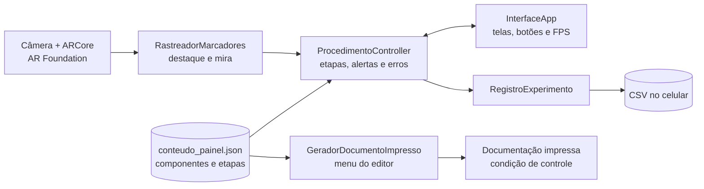
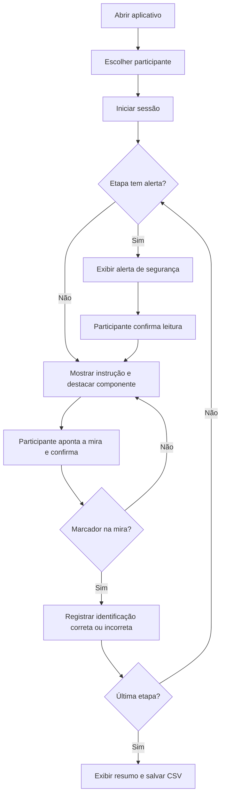
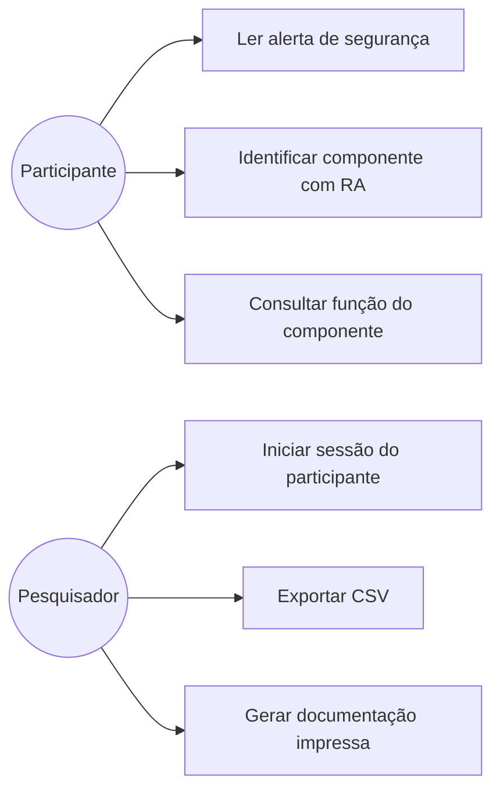

# Painel AR — Identificação de Componentes em Painéis Elétricos

> **UPX — Realidade Aumentada · Centro Universitário Facens**  
> Prova de conceito de aplicativo Android de Realidade Aumentada baseada em marcadores para apoiar a identificação de componentes e a execução guiada de um procedimento de manutenção em um painel elétrico didático desenergizado.


-green)


---

## 1. Identificação do Projeto

| Item | Informação |
|---|---|
| **Projeto** | Painel AR — Realidade Aumentada Baseada em Marcadores para Apoio à Identificação de Componentes e Execução de Procedimentos de Manutenção em Painéis Elétricos |
| **Equipe** | Equipe 4 |
| **Curso** | Engenharia de Computação |
| **Disciplina** | UPX — Realidade Aumentada |
| **Professor** | Daniel Ohata |
| **Semestre** | 2026.2 |
| **Instituição** | Centro Universitário Facens — Sorocaba, SP |

### Integrantes

| Nome | RA | Responsabilidade |
|---|---|---|
| Enrico Affonso Fernandes Alves | 210141 | Desenvolvimento AR |
| Guilherme Luiz Rodrigues Ifanger | 235438 | Documentação |
| Kauan Michael de Freitas | 236023 | Desenvolvimento AR |

---

## 2. Visão Geral

O **Painel AR** é um aplicativo Android de Realidade Aumentada que reconhece marcadores impressos colados ao lado dos componentes de um painel elétrico didático. Ao apontar a câmera para um marcador, o aplicativo mostra o nome do componente, sua função e alertas de segurança, e conduz o usuário por um procedimento de manutenção simulado de 15 etapas.

O aplicativo é o instrumento da condição experimental de RA do artigo científico da equipe. Durante a tarefa, ele registra cada identificação feita pelo participante e calcula a **taxa de erros de identificação**, que é comparada com o uso de documentação impressa de conteúdo equivalente.

O estudo é feito exclusivamente em painel **desenergizado**, sem intervenção elétrica real, e com conteúdo técnico revisado por profissional da área.


---

## 3. Problema

Atividades de manutenção elétrica expõem o trabalhador a riscos como choque elétrico e arco elétrico. Um dos fatores que pode agravar esse risco é o erro na identificação de componentes: operadores em treinamento e profissionais menos experientes costumam depender de manuais impressos, etiquetas físicas ou memorização para localizar o componente certo antes de executar um procedimento.

A RA já é aplicada em manutenção industrial, mas, nos trabalhos analisados pela equipe, não foi encontrada uma avaliação experimental que compare uma aplicação de RA real, baseada em marcadores, com documentação impressa equivalente quanto à taxa de erros de identificação em um painel elétrico físico.

**Questão de pesquisa (RQ1):** qual é o efeito do uso de uma aplicação de RA baseada em marcadores, em comparação ao uso de documentação tradicional impressa, sobre a taxa de erros de identificação de componentes durante a execução de um procedimento de manutenção em um painel elétrico didático?

**Hipótese (H1):** usuários que utilizam a aplicação de RA apresentarão menor taxa de erros na identificação dos componentes do que usuários que utilizam documentação impressa.

---

## 4. Objetivos

### 4.1 Objetivo Geral

Desenvolver e avaliar uma prova de conceito de aplicação móvel de Realidade Aumentada baseada em marcadores para apoiar a identificação de componentes e a execução guiada de um procedimento de manutenção em um painel elétrico didático desenergizado.

### 4.2 Objetivos Técnicos

- Configurar um projeto Unity 6.3 com AR Foundation e ARCore para Android.
- Reconhecer três marcadores impressos, cada um associado a um componente do painel.
- Exibir, sobre cada marcador, o nome do componente e um destaque visual.
- Mostrar função e alertas de segurança do componente que está na mira.
- Conduzir um procedimento de 15 etapas com alerta obrigatório antes das etapas críticas.
- Registrar em CSV, no próprio aparelho, cada evento da sessão e cada identificação (correta ou incorreta).
- Gerar a documentação impressa a partir do mesmo arquivo de conteúdo do aplicativo.
- Executar testes técnicos de reconhecimento, desempenho e estabilidade antes do experimento.

---

## 5. Público-Alvo

Operadores em treinamento, estudantes de cursos técnicos e de engenharia e profissionais menos experientes que precisam identificar componentes de um painel elétrico antes de executar um procedimento de manutenção.

No experimento, participam de 2 a 4 voluntários, com registro da familiaridade prévia de cada um com componentes e procedimentos de manutenção elétrica.

Materiais complementares (perfil dos participantes, termo de consentimento, protocolo do experimento) ficam em `docs/documents/`.

---

## 6. Funcionalidades

| ID | Funcionalidade | Descrição | Status |
|---|---|---|---|
| RF01 | Acessar o painel pela câmera | Abre a câmera em modo RA e inicia a sessão do participante | 🚧 |
| RF02 | Reconhecer marcadores | Reconhece os 3 marcadores cadastrados na Reference Image Library | 🚧 |
| RF03 | Identificar o componente | O participante aponta a mira para um marcador e confirma | 🚧 |
| RF04 | Conhecer o componente | Mostra nome, função e alerta do componente na mira | 🚧 |
| RF05 | Agir com segurança | Exibe alerta obrigatório antes das etapas críticas | 🚧 |
| RF06 | Seguir o procedimento | Conduz as 15 etapas e destaca o componente pedido | 🚧 |
| RF07 | Medir o desempenho | Grava um CSV por participante com todos os eventos | 🚧 |
| RF08 | Medir o erro | Conta identificações incorretas e calcula a taxa de erros | 🚧 |

**Legenda:** ✅ Implementado e testado no dispositivo · 🚧 Em desenvolvimento · ⬜ Planejado · ❌ Cancelado

---

## 7. Requisitos Não Funcionais

| ID | Categoria | Requisito |
|---|---|---|
| RNF01 | Plataforma | Executar em smartphones Android compatíveis com ARCore, sem acessórios adicionais |
| RNF02 | Qualidade de rastreamento | Reconhecer corretamente os marcadores nas condições de iluminação, distância e ângulo do experimento, sem falsos reconhecimentos |
| RNF03 | Desempenho | Manter o rastreamento utilizável durante a tarefa, com referência inicial de 15 FPS |
| RNF04 | Estabilidade | Completar uma sessão experimental sem falhas que exijam reinício da aplicação |
| RNF05 | Disponibilidade | Operar sem conexão com a internet, com o conteúdo armazenado localmente |
| RNF06 | Usabilidade | Textos legíveis à distância de uso e operação com uma das mãos |
| RNF07 | Equivalência de conteúdo | Gerar a documentação impressa e o conteúdo do aplicativo a partir da mesma fonte de dados |
| RNF08 | Segurança e privacidade | Uso restrito ao painel didático desenergizado, conteúdo revisado por profissional e dados dos participantes anonimizados |

---

## 8. Tecnologias Utilizadas

| Tecnologia | Versão | Utilização |
|---|---|---|
| Unity | 6000.3.x (6.3 LTS) | Desenvolvimento principal |
| C# | compatível com Unity 6.3 | Scripts da aplicação |
| AR Foundation | 6.3.5 | Camada de abstração de RA (image tracking) |
| Google ARCore XR Plugin | 6.3.5 | Recursos de RA no Android |
| XR Plugin Management | 4.6.1 | Gerenciamento de plugins XR |
| Android SDK/NDK + OpenJDK | instalados pelo Unity Hub | Build Android (IL2CPP, ARM64) |
| arcoreimg (ARCore SDK) | — | Avaliação da qualidade das imagens dos marcadores |
| Git / GitHub | 2.x / — | Controle de versão e documentação |

> Base técnica: projeto *white label* **WL03 — Contextual AR** da disciplina, adaptado para múltiplos marcadores e registro experimental.

---

## 9. Hardware Utilizado

| Equipamento | Modelo | Característica relevante | Utilização |
|---|---|---|---|
| Smartphone | XXX  | Android com suporte a ARCore | Execução, testes e experimento |
| Computador | XXX | Windows 10/11 64 bits, CPU, RAM, GPU | Desenvolvimento e build |
| Painel elétrico didático | Preencher | Desenergizado, com disjuntor, contator e relé de sobrecarga | Cenário do experimento |
| Marcadores impressos | — | 3 imagens, cerca de 8 cm de largura, papel fosco | Referências de rastreamento |

---

## 10. Arquitetura do Sistema

A solução é organizada em captura da imagem, reconhecimento de marcadores, identificação do componente (consulta à base local), apresentação de informações e registro dos eventos da tarefa experimental.



### Fluxo resumido

```text
Participante
   ↓
InterfaceApp (telas e botões)
   ↓
ProcedimentoController (etapas, alertas, contagem de erros)
   ↓                         ↓
RastreadorMarcadores    RegistroExperimento → CSV
   ↓
AR Foundation → ARCore → Câmera
   ↓
Marcadores no painel didático
```

---

## 11. Funcionamento da Realidade Aumentada

### 11.1 Técnica utilizada

**Image Tracking baseado em marcadores.** Três imagens de referência, uma por componente, são cadastradas numa `XRReferenceImageLibrary` com seu tamanho físico real. A abordagem com marcadores foi escolhida por ser mais simples e adequada a uma prova de conceito em ambiente controlado do que abordagens *markerless*.

### 11.2 Fluxo técnico

1. O aplicativo inicia a câmera e a sessão ARCore.
2. O `ARTrackedImageManager` compara continuamente a imagem da câmera com a biblioteca de marcadores.
3. Quando um marcador é reconhecido, o `RastreadorMarcadores` cria sobre ele uma placa semitransparente e um rótulo 3D com o nome do componente.
4. O componente pedido na etapa atual fica destacado em laranja; os demais, em azul.
5. A cada quadro, o aplicativo calcula qual marcador visível está mais próximo da mira no centro da tela.
6. O participante toca em **Confirmar componente**; o aplicativo compara o componente indicado com o pedido na etapa, registra o resultado e avança.

### 11.3 Elementos virtuais

- placa colorida sobre cada marcador reconhecido;
- rótulo 3D com o nome do componente, sempre voltado para a câmera;
- destaque do componente da etapa atual;
- mira no centro da tela, que fica verde quando há um componente sob ela;
- cartão com nome, função e alerta do componente na mira;
- tela de alerta de segurança antes das etapas críticas;
- indicador de progresso (etapa X de 15) e contador de FPS.

### 11.4 Registro do experimento

Cada sessão gera um arquivo `P01_RA_AAAAMMDD_HHMMSS.csv` na pasta do aplicativo no celular, gravado linha a linha para não perder dados em caso de falha.

| Evento | Quando é registrado |
|---|---|
| `SESSAO_INICIO` / `SESSAO_FIM` | Início da sessão / fim da etapa 15, com acertos, erros e taxa |
| `ETAPA_INICIO` | Início de cada etapa |
| `ALERTA_EXIBIDO` / `ALERTA_CONFIRMADO` | Tela de alerta aparece / participante confirma a leitura |
| `MARCADOR_VISIVEL` | Um marcador passa a ser visto pela câmera |
| `INFO_EXIBIDA` | Muda o componente na mira e suas informações aparecem |
| `IDENTIFICACAO` | Participante confirma um componente (`correto` = 1 ou 0) |
| `CONFIRMACAO_SEM_MARCADOR` | Toque em Confirmar sem marcador na mira (não conta como identificação) |

**Taxa de erros (%) = identificações incorretas ÷ 15 × 100**, com 15 identificações por participante (3 componentes × 5 etapas).

---

## 12. Estrutura do Projeto

```text
painel-ar/
│
├── Assets/
│   ├── Editor/
│   │   └── GeradorDocumentoImpresso.cs
│   ├── Markers/
│   │   ├── marcador_DJ1.png
│   │   ├── marcador_K1.png
│   │   └── marcador_FT1.png
│   ├── ReferenceImages/
│   │   └── PainelReferenceImageLibrary.asset
│   ├── Resources/
│   │   └── conteudo_painel.json
│   ├── Scenes/
│   │   └── WL03ContextualAR.unity
│   ├── Scripts/
│   │   ├── ConteudoPainel.cs
│   │   ├── InterfaceApp.cs
│   │   ├── ProcedimentoController.cs
│   │   ├── RastreadorMarcadores.cs
│   │   └── RegistroExperimento.cs
│   └── XR/
│
├── Packages/
├── ProjectSettings/
│
├── docs/
│   ├── diagrams/
│   ├── documents/
│   └── images/
│
├── .gitignore
├── CHANGELOG.md
└── README.md
```

### Pastas principais

| Pasta | Finalidade |
|---|---|
| `Assets/Scripts` | Scripts da aplicação produzidos pela equipe |
| `Assets/Editor` | Ferramentas do editor (gerador da documentação impressa); não vão para o APK |
| `Assets/Resources` | Arquivo de conteúdo lido pelo app em tempo de execução |
| `Assets/Markers` | Imagens dos marcadores impressos |
| `Assets/ReferenceImages` | Biblioteca de marcadores usada pelo ARCore |
| `Assets/Scenes` | Cena principal de RA |
| `docs/diagrams` | Diagramas técnicos |
| `docs/images` | Screenshots e fotos do experimento |
| `docs/documents` | Artigo, protocolo experimental, registro da validação técnica |

---

## 13. Principais Scripts

| Script | Responsabilidade |
|---|---|
| `ConteudoPainel.cs` | Lê `conteudo_painel.json` e valida que toda etapa aponta para um componente existente |
| `RastreadorMarcadores.cs` | Recebe os marcadores do AR Foundation, desenha destaque e rótulo e informa qual está na mira |
| `ProcedimentoController.cs` | Controla as fases da sessão (início, alerta, identificação, conclusão) e conta acertos e erros |
| `InterfaceApp.cs` | Desenha as telas, a mira, os botões e o contador de FPS |
| `RegistroExperimento.cs` | Grava cada evento em uma linha do CSV da sessão |
| `GeradorDocumentoImpresso.cs` | Menu **Painel AR → Gerar documentação impressa**: gera o manual/checklist em HTML a partir do mesmo JSON |

---

## 14. Dependências

```text
com.unity.xr.arfoundation   6.3.5
com.unity.xr.arcore         6.3.5
com.unity.xr.management     4.6.1
```

Render pipeline: Built-in. A interface usa IMGUI e `TextMesh`, sem dependência de TextMeshPro.

---

## 15. Configuração do Ambiente

### Pré-requisitos

- Windows 10 ou 11, 64 bits;
- Unity Hub;
- Unity 6.3 LTS (`6000.3.x`) com **Android Build Support**, **OpenJDK** e **Android SDK & NDK Tools**;
- Git;
- smartphone Android compatível com ARCore, com **Google Play Services for AR** instalado, modo desenvolvedor e depuração USB ativos.

### Procedimento

1. Instale o Unity Hub e o Unity 6.3 LTS com os módulos Android.
2. Instale o Git.
3. Clone o repositório em um caminho curto, sem espaços nem acentos (por exemplo `C:\AR\`).
4. Abra o projeto pelo Unity Hub e aguarde a importação.
5. Confira em **Edit → Project Settings → XR Plug-in Management** que o ARCore está habilitado na aba Android.
6. Confira em `XR Origin (Mobile AR)` que o **AR Tracked Image Manager** usa a `PainelReferenceImageLibrary`.

---

## 16. Como Executar

```bash
git clone https://github.com/USUARIO/REPOSITORIO.git
cd REPOSITORIO
```

Depois:

1. Abra o Unity Hub e clique em **Add → Add project from disk**.
2. Selecione a pasta clonada e confirme a versão 6000.3.x.
3. Abra a cena `Assets/Scenes/WL03ContextualAR.unity`.
4. Em **File → Build Profiles**, confirme que a plataforma ativa é **Android**.
5. Conecte o smartphone com depuração USB ativa e selecione-o em **Run Device**.
6. Clique em **Build And Run**.

Para gerar a documentação impressa: **Painel AR → Gerar documentação impressa**. O arquivo `Documentacao_Impressa.html` é criado na raiz do projeto.

---

## 17. Como Utilizar a Aplicação

1. Abra o **Painel AR** no smartphone e autorize o acesso à câmera.
2. Escolha o código do participante (P01, P02…) com os botões **−** e **+**.
3. Toque em **Iniciar sessão**.
4. Quando aparecer a tela de alerta, leia e toque em **Li e entendi**.
5. Leia a instrução da etapa e aponte a mira para o marcador do componente pedido (destacado em laranja).
6. Confira o nome em **Na mira** e toque em **Confirmar componente**.
7. Repita até a etapa 15. A tela final mostra acertos, erros, taxa de erros, tempo e o caminho do arquivo CSV.
8. Toque em **Próximo participante** para iniciar uma nova sessão.


---

## 18. Fluxo de Funcionamento



---

## 19. Caso de Uso



---

## 20. Fluxo de Navegação

```text
Tela Inicial (participante)
    ↓
Alerta de Segurança (quando a etapa tem alerta)
    ↓
Etapa: instrução + mira + componente na mira
    ↓  (repete 15 vezes)
Resumo da Sessão
    ↓
Próximo Participante → Tela Inicial
```

---

## 21. Interface

Armazene screenshots reais do projeto em `docs/images/`:

```text
docs/images/
├── tela-inicial.png
├── alerta-seguranca.png
├── etapa-componente-na-mira.png
├── resumo-sessao.png
└── painel-com-marcadores.jpg
```

---

## 22. Testes Técnicos

Critérios definidos antes da execução, conforme a Seção 3.9 do artigo. Realizados no painel didático, com o smartphone do experimento.

| Teste | Procedimento | Resultado esperado | Resultado obtido | Status |
|---|---|---|---|---|
| Reconhecimento por distância | 10 tentativas por marcador a 30, 50 e 80 cm | 10/10 a 30 e 50 cm; ≥ 9/10 a 80 cm | Preencher | ⬜ |
| Reconhecimento por ângulo | 10 tentativas a 50 cm, a 0°, 30° e 45° | ≥ 9/10 em cada ângulo | Preencher | ⬜ |
| Iluminação | 10 tentativas a 50 cm, luz normal e reduzida | ≥ 9/10 em cada condição | Preencher | ⬜ |
| Associação correta | Mira em cada marcador, conferir nome exibido | Nenhuma associação errada | Preencher | ⬜ |
| Desempenho | Observar FPS durante uma sessão completa | Sempre ≥ 15 FPS | Preencher | ⬜ |
| Estabilidade | 3 sessões completas seguidas | Nenhum travamento ou reinício | Preencher | ⬜ |
| Operação offline | 1 sessão em modo avião | Sessão completa | Preencher | ⬜ |
| Registro de dados | Conferir CSVs das sessões de teste | 15 linhas `IDENTIFICACAO` por sessão; erros iguais aos provocados | Preencher | ⬜ |

---

## 23. Dispositivos Testados

| Dispositivo | Sistema | Versão | Resultado |
|---|---|---|---|
| Preencher | Android | Preencher | Preencher |

---

## 24. Limitações Conhecidas

- O reconhecimento depende de iluminação adequada, papel fosco e marcadores planos e visíveis.
- Funciona apenas em aparelhos compatíveis com ARCore.
- Prova de conceito com 3 componentes e um único procedimento.
- A amostra prevista (2 a 4 participantes) permite apenas análise descritiva, sem inferência estatística.
- Os resultados valem para uma tarefa controlada em painel desenergizado e não devem ser generalizados para manutenção real nem interpretados como redução de acidentes.
- Mudanças no conteúdo exigem novo build, porque o JSON é empacotado dentro do APK.
- O conteúdo técnico do arquivo `conteudo_painel.json` é provisório até a validação pelo profissional da área.

---

## 25. Evidências de Funcionamento

- Captura de tela de cada tela do aplicativo (seção 21).
- Foto do painel didático com os marcadores colados.
- Vídeo da experiência RA durante uma sessão completa.
- CSVs anonimizados das sessões de teste em `docs/documents/`.

[Assistir demonstração](COLE_AQUI_O_LINK_DO_VIDEO)

---

## 26. Repositórios e Recursos

| Recurso | Link |
|---|---|
| Código-fonte | Inserir URL |
| Artigo científico | `docs/documents/` |
| Figma / protótipos de interface | Inserir URL |
| Trello/Jira | Inserir URL |
| Vídeo | Inserir URL |

---

## 27. Cronograma Técnico

Estimativa de 6 semanas e cerca de 100 horas de trabalho da equipe.

| Atividade | Responsável | Status |
|---|---|---|
| Revisão bibliográfica | Equipe | ✅ |
| Definição do painel, componentes e procedimento | Preencher | 🚧 |
| Validação técnica do conteúdo por profissional | Preencher | ⬜ |
| Protótipos de interface | Preencher | ⬜ |
| Implementação da aplicação | Preencher | 🚧 |
| Integração do reconhecimento de marcadores | Preencher | 🚧 |
| Testes técnicos | Preencher | ⬜ |
| Protocolo experimental | Preencher | ⬜ |
| Coleta e análise dos dados | Equipe | ⬜ |
| Versão final do artigo | Equipe | ⬜ |

---

## 28. Problemas Encontrados e Soluções

---

## 29. Melhorias Futuras

- ampliar o número de componentes e procedimentos;
- carregar o conteúdo de um arquivo externo, sem precisar de novo build;
- exportar os CSVs direto pelo aplicativo (compartilhamento);
- adicionar instrumento NASA-TLX ao fim da sessão;
- avaliar rastreamento *markerless* em painéis reais;
- repetir o experimento com amostra maior para permitir análise estatística.

---

## 30. Custos e Recursos

| Recurso | Tipo | Custo/Condição |
|---|---|---|
| Unity | Software | Licença Personal (gratuita) |
| AR Foundation / ARCore | Software | Gratuitos |
| Smartphone Android com ARCore | Hardware | Equipamento da equipe |
| Computador | Hardware | Equipamento da equipe |
| Painel elétrico didático | Hardware | Laboratório da instituição |
| Impressão dos marcadores e da documentação | Material | Baixo custo |

---

## 31. Licença

---

## 32. Autores

- **Enrico Affonso Fernandes Alves** — Desenvolvimento RA
- **Guilherme Luiz Rodrigues Ifanger** — Documentação
- **Kauan Michael de Freitas** — Desenvolvimento RA

**Instituição:** Centro Universitário Facens  
**Disciplina:** UPX — Realidade Aumentada  
**Semestre:** 2026.2
