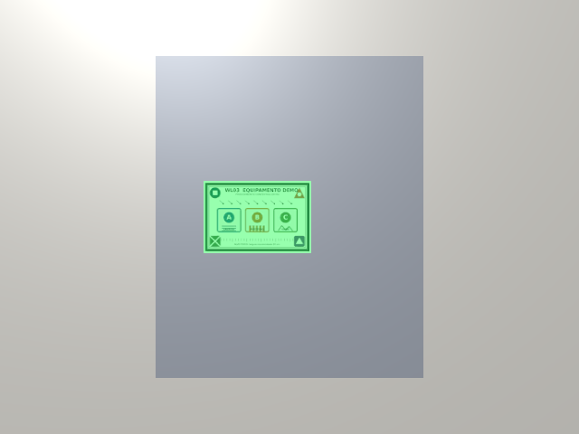

# Testar no PC com o XR Simulation

O Play do editor roda o app com o **XR Simulation** do AR Foundation: em vez da câmera do celular, o Unity mostra um ambiente virtual (`Assets/Simulacao/AmbientePainel.prefab`) com um painel e os marcadores da Reference Image Library. Não precisa baixar nada nem conectar celular.

Serve para testar a lógica do app. Não substitui os testes técnicos no celular (iluminação, distância, ângulo, FPS), porque o reconhecimento simulado não processa imagem de verdade.

## Passo a passo

1. Abra o **Unity Hub** → **Projects** → **Add** → **Add project from disk** e escolha `C:\AR\PainelAR\painel-ar`.
2. Se o Hub perguntar a versão do editor, escolha **6000.6.7f1** (é a que tem Android instalado).
3. Com o projeto aberto, a cena `Assets/Scenes/WL03ContextualAR` já deve estar carregada. Se não estiver, dê dois cliques nela na janela **Project**.
4. Clique na aba **Game** e, no menu de resolução dela (canto superior esquerdo), escolha uma proporção em pé, como 1080x1920, para parecer um celular (opcional).
5. Clique em **Play** (▶ no topo).
6. Clique dentro da janela **Game** e ande pelo ambiente:

| Ação | Controle |
| --- | --- |
| Olhar em volta | segure o **botão direito** do mouse e mova o mouse |
| Andar | segure o botão direito e use **W A S D** |
| Subir / descer | **E** / **Q** (com o botão direito pressionado) |
| Andar mais rápido | **Shift** |

## O que deve acontecer

- A câmera começa a 70 cm do painel cinza, com o marcador na frente.
- Em menos de 1 segundo o marcador ganha uma **placa verde** por cima, e o quadro no topo da tela mostra `WL03EquipmentTarget: VISÍVEL`.
- Vire a câmera para longe: o quadro passa a mostrar `fora da vista` e a placa some.
- Volte a olhar para o marcador: ele é reconhecido de novo.

Clique em **Play** de novo para parar.

O marcador atual ainda é o do WL03. Na Fase 2 ele é trocado pelos 3 marcadores do painel, e o ambiente é gerado de novo com eles (`Painel AR → Simulação → Configurar simulação no PC`).

## Teste automático (sem abrir o editor)

Com o Unity **fechado**:

```
powershell -ExecutionPolicy Bypass -File tools\unity.ps1 TesteSimulacao.Executar -SemSair
```

Ele entra em Play, espera os marcadores serem reconhecidos, salva `Logs/teste_simulacao.png` e termina com `TESTE SIMULACAO OK` ou `FALHOU`.



## Se algo der errado

| Sintoma | O que fazer |
| --- | --- |
| Tela preta ou cinza vazia no Play | Confira em **Edit → Project Settings → XR Plug-in Management**, aba do PC (monitor), se **XR Simulation** está marcado. Se não estiver, rode **Painel AR → Simulação → Configurar simulação no PC** |
| A câmera não se mexe | Clique dentro da janela **Game** e mantenha o **botão direito** pressionado enquanto usa as teclas |
| Aviso pedindo para reiniciar por causa do Input System | Aceite; o projeto usa "Both" (Input Manager + Input System) |
| O marcador aparece, mas nunca fica verde | Rode **Painel AR → Configurar projeto** (zera o Camera Y Offset do XR Origin) e depois a configuração da simulação |
